# Envío Mail

Esta extensión incluye la funcionalidad de adjuntar un documento del programa (pedido, factura, etc.) en un e-mail a un cliente / provedor.

## Configuración

Para el correcto funcionamiento de envío mail hay que configurar unos parámetros generales y según el cliente de correo y el sistema operativo tendremos que realizar unas configuraciones específicas.

### Configuración general

Dentro de **Área de Facturación -> Principal -> Empresa** iremos a la pestaña **Configuración local** y dentro de esta a **Envío mail**.
Aquí tenemos que informar:
- Tipo de cliente de correo: Seleccionaremos un valor entre los posibles (Eneboo, Kmail, Thunderbird, Outlook, Python)
- Directorio temporal: Inforaremos la carpeta donde se guardarán temporalmente los adjuntos del correo.

> **Importante:** esta configuración es **local**: hay que hacerla en **cada ordenador** desde el que se envíen correos. El directorio temporal debe existir, el usuario debe poder escribir en él y la ruta **no puede contener espacios** (por ejemplo `C:\EnebooCorreo` en Windows o `/home/usuario/correo` en Linux). Con una ruta con espacios, o sin directorio, el correo no se puede enviar.

### Configuración Python (envío directo desde Eneboo)

Con el tipo de cliente de correo **Python** y sin informar el nombre del ejecutable, Eneboo envía el correo directamente con el programa *aqextension* que se instala junto a Eneboo. No hace falta tener instalado ningún programa de correo. Es el modo que permite revisar destinatarios, copias, adjuntos y texto en la ventana de envío de e-mail (ver más abajo).

Cada usuario configura su cuenta de correo en **Área de Facturación -> Principal -> Usuarios**, en su ficha, apartado **Envío mail**:

- Host correo saliente, Puerto SMTP, Tipo conexión SMTP y Tipo autenticación SMTP: los datos del servidor de correo.
- Usuario SMTP y contraseña: la cuenta desde la que se envía. Con Gmail hay que usar una **contraseña de aplicación** de Google, no la contraseña normal de la cuenta.
- Firma pie correo: texto que se añade al final de cada correo.
- Nombre (y ruta) de la imagen para firma correo: imagen opcional que se añade debajo de la firma.
- Configuración IMAP: si se marca *Añadir copia a carpeta Enviados*, el correo enviado se guarda también en la carpeta de enviados de la cuenta.

Junto a la contraseña está el botón de **correo de prueba**: pide una dirección y envía un mensaje corto para comprobar que la cuenta está bien configurada.

### Configuración Thunderbird
#### Linux
- Nombre y ruta de la aplicación: Por defecto lo informa al seleccionar el tipo de correo, si no lo hace hay que informar *thunderbird*

#### Windows

- Nombre y ruta de la aplicación: Informaremos la **ruta completa** del ejecutable de Thunderbird:

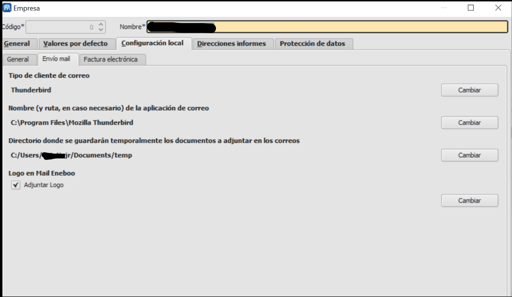

- Variables de entorno: Editaremos las variables de entorno y añadiremos una entrada al path con la ruta completa del ejecutable de Thunderbird:

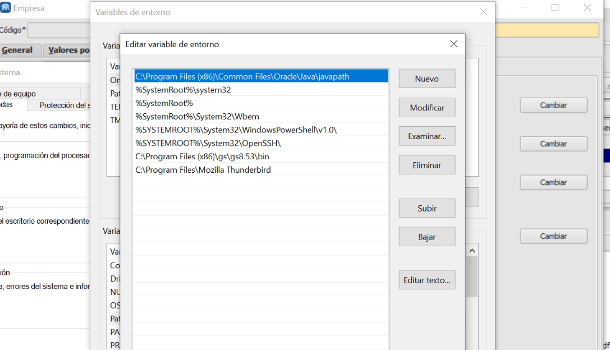

### Configuración Outlook
#### Windows

- Nombre y ruta de la aplicación: Informaremos la **ruta completa** del ejecutable de Outlook:

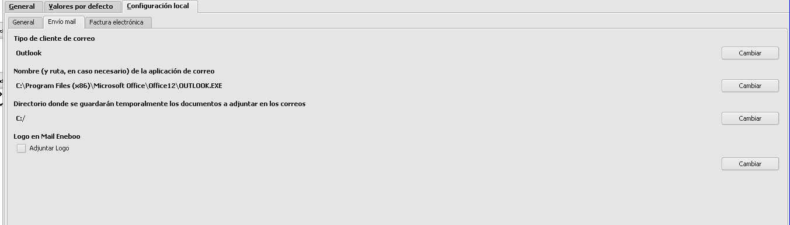

- Variables de entorno: Editaremos las variables de entorno y añadiremos una entrada al path con la ruta completa del ejecutable de Outlook:

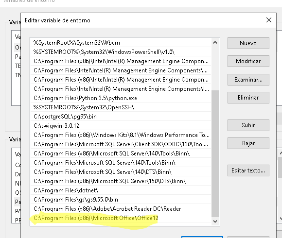

## Configuración de e-mails en clientes

- Cuando enviemos un e-mail desde presupuestos, pedidos, albaranes o facturas, el e-mail al que se enviará el correo será el que esté configurado en la ficha del cliente, bien en el campo *E-mail* de la pestaña **General** o bien en los e-mails configuarados en la pestaña de **Agenda**.

### Configuración e-mail principal

- En la pestaña **General** de la ficha de clientes informaremos el e-mail principal del cliente

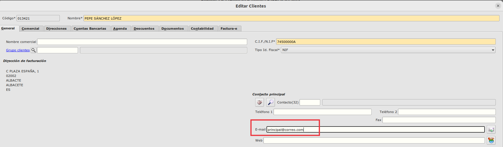

### Configuración e-mail contactos

- En la pestaña de **Agenda** de la ficha de clientes tenemos una tabla para asignar distintos contactos al cliente, cada contacto tiene un campo para informar su e-mail.

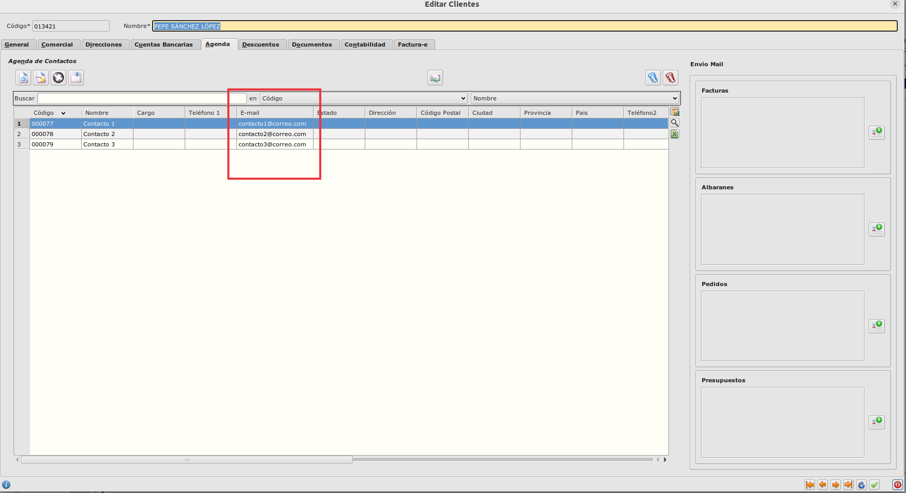

- En la misma pestaña, en la parte de la derecha podemos configurar para cada tipo de documento uno o varios e-mails de tal forma que al seleccionar un documento desde su maestro y pulsar sobre el botón de envío mail, se enviará a las direcciones de correos que se hayan configurado según el tipo de documento.

- Si queremos configurar los e-mails destinos a los que se enviarán cuando pulsemos en enviar correo desde el maestro de facturas, pulsaremos sobre el botón de añadir e-mails en el recuadro de facturas.

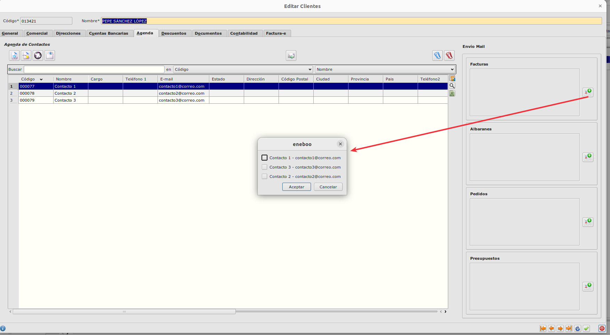

- Seleccionaremos una o varias direcciones de correo y aceptaremos.

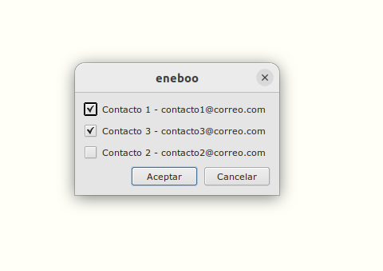

- Se quedarán guardadas las direcciones de los e-mails de dicho cliente a los que se enviarán los correos cuando pulsemos el botón de enviar e-mail de una factura de dicho cliente.

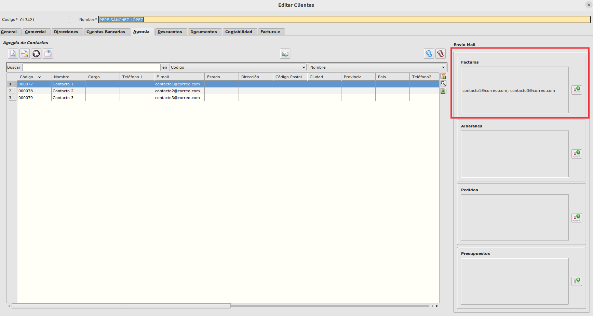


### Prioridad de selección de e-mail

- A la hora de enviar un documento por e-mail, primero se mirará si existe para el tipo de documento uno o varios e-mails configurados en la pestaña **Agenda** de la ficha del cliente, si no existe ningún e-mail configurado para el tipo de documento entonces mirará el e-mail configurado en la pestaña **General** 

- Con el tipo de cliente de correo **Python** (envío directo desde Eneboo) la ventana de envío se rellena así, para que nadie deje de recibir el documento:
    - **Para:** el e-mail principal de la pestaña **General**. Si el cliente no lo tiene, el primer e-mail de sus contactos.
    - **CC:** los e-mails configurados para ese tipo de documento en la pestaña **Agenda**.
    - El resto de e-mails del cliente quedan disponibles en los desplegables para añadirlos si se quiere.


## Envío de e-mail desde maestro de documentos

- En los maestros de presupuestos, pedidos, albaranes y facturas de clientes existe un botón el cual teniendo seleccionado un documento, enviará un e-mail a la dirección de correo configurada siguiendo la prioridad descrita anteriormente adjuntando una copia del impreso del documento correspondiente.

- En el ejemplo podemos ver como se adjunta la factura 20230A000001 y se envía a los destinatarios que habíamos configurado en la ficha del cliente, en la pestaña de Agenda en el recuadro de facturas.

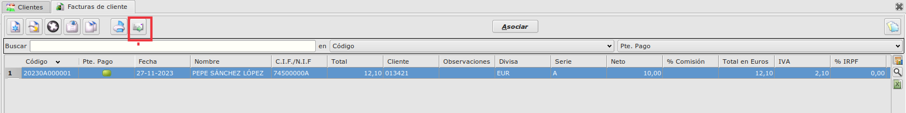

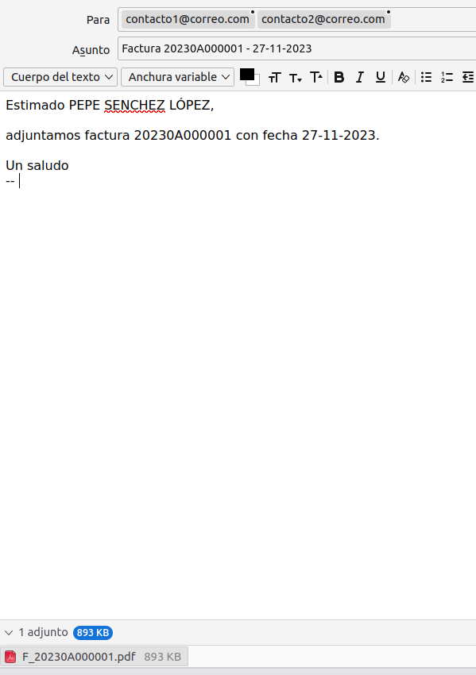


## Ventana de envío de e-mail

Con el tipo de cliente de correo **Python**, al pulsar el botón de envío se genera el PDF del documento y se abre la ventana **Envío de email**, donde se revisa todo antes de enviar:

| Campo | Para qué sirve |
| --- | --- |
| Para | Destinatarios principales |
| CC | Con copia: reciben el correo y los demás destinatarios lo ven |
| CCo | Con copia oculta: reciben el correo pero nadie ve su dirección |
| Adjuntos | Ficheros que se envían; por defecto, el PDF del documento |
| Asunto | Asunto del correo (de la plantilla, si existe) |
| Cuerpo | Texto del correo (de la plantilla, si existe) |

### Destinatarios: Para, CC y CCo

- En cada campo se pueden escribir varias direcciones separadas por comas (también se admite `;`).
- A la derecha de cada campo hay un desplegable **Añadir / quitar...**:
    - Las opciones que empiezan por **+** añaden al campo un e-mail del cliente (ficha y contactos). Al añadirlo desaparece de los tres desplegables, para no enviarlo dos veces.
    - Las opciones que empiezan por **-** quitan del campo una dirección que ya tiene. Al quitarla vuelve a estar disponible.
    - La opción **Yo** es la dirección del propio usuario: añadiéndola en CCo se recibe una copia oculta del correo enviado.
- Si una misma dirección está en varios campos, se envía una sola vez.
- Al pulsar **Aceptar** se comprueban las direcciones: si falta el destinatario o alguna está mal escrita, se avisa y la ventana sigue abierta con todo lo escrito.

### Adjuntos

- Por defecto se adjunta el PDF del documento.
- En el desplegable **Añadir / quitar adjunto...**:
    - **+ Añadir fichero...** cierra un momento la ventana, abre el selector de ficheros y la vuelve a abrir con todo lo escrito y el fichero nuevo en la lista.
    - **- Quitar ...** quita ese adjunto del correo.
- Se pueden adjuntar ficheros de carpetas o con nombres que tengan espacios.

### Asunto y cuerpo

- El cuerpo se ve con formato (negritas, párrafos) y se puede modificar o completar escribiendo directamente.
- El correo se envía siempre con formato (HTML), con acentos, ñ y símbolos como € correctos.
- La firma del usuario (texto e imagen) se añade sola al final; no hace falta escribirla.


## Uso de plantillas en envío de correos

- Desde el **Área de facturación -> Más -> Principal -> Plantillas mail** podemos crear plantillas para el envío de mail

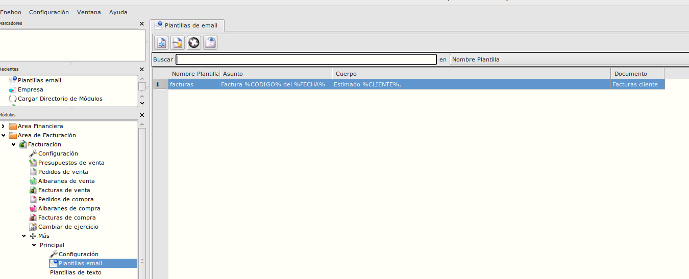


- Para crear una nueva plantilla pulsaremos en nuevo registro e informaremos los siguientes campos: *Asunto* (asunto del correo), *Cuerpo* (el texto del correo) y *Nombre Plantilla* (es el nombre de la plantilla) y seleccionaremos en el depl

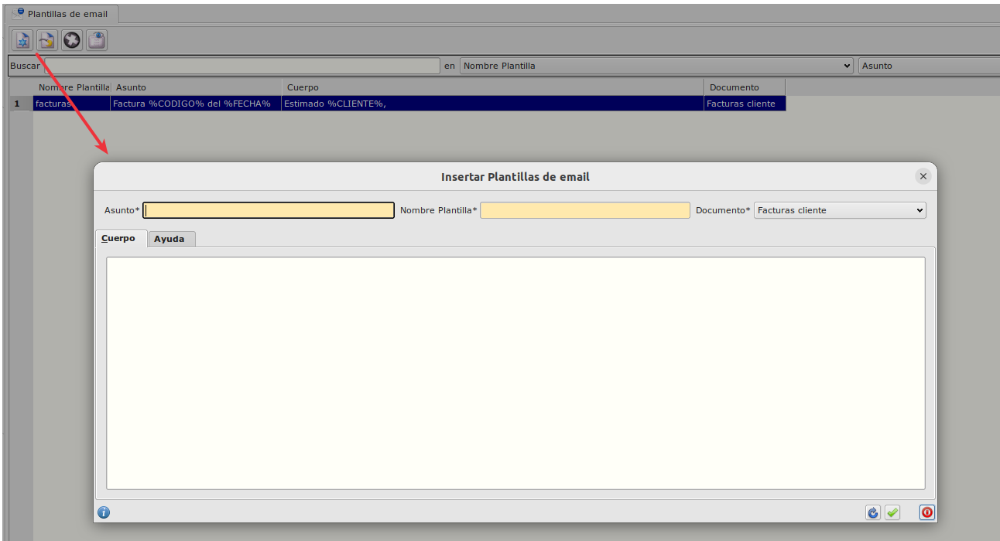

    . Asunto: Asunto asunto del correo.
    . Cuerpo: El texto del correo
    . Nombre plantilla: Nombre que le damos a la plantilla
    . Documento: Desplegable con el tipo de documento en el que se utilizará la plantilla.


- En los campos *Asunto* y *Cuerpo* podremos utilizar etiquetas las cuales se sustituirán al enviar el mail con los datos del documento que se va a enviar.

- En la pestaña de *Ayuda* podemos ver que etiquetas se pueden usar y por qué datos serán sustituidas:

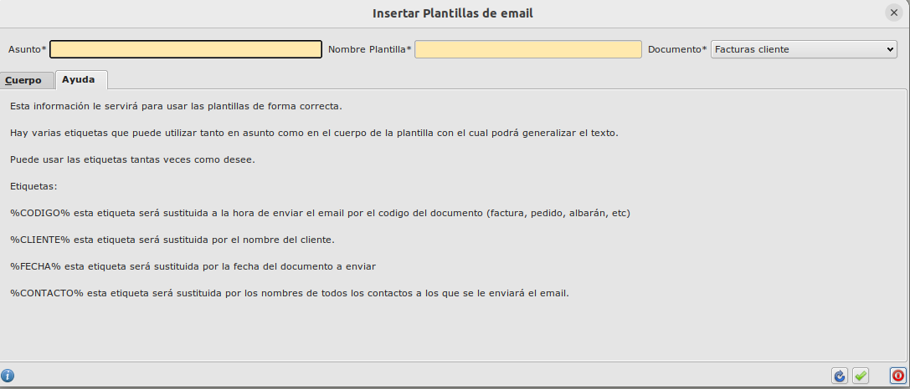

### Ejemplo de plantilla

* En el siguiente ejemplo podemos ver una plantilla que se utliza en facturas donde utilizamos las etiquetas que se sustituirán por el nombre del cliente, el código de la factura y la fecha del documento.

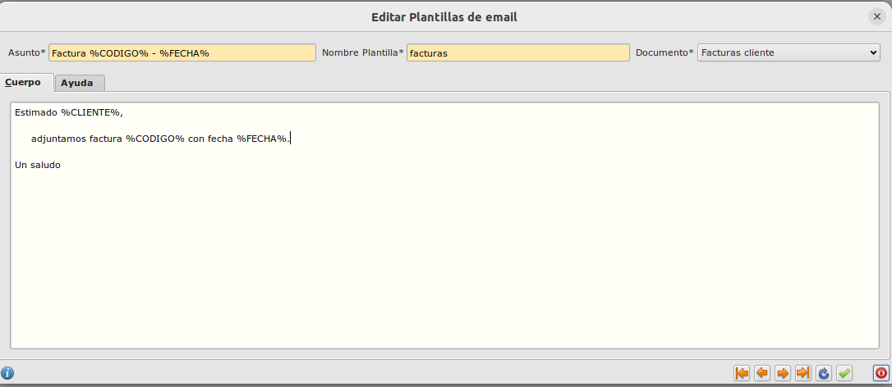

* La factura 20230A00001 con fecha 27-11-2023 es del cliente *PEPE SÁNCHEZ LÓPEZ*

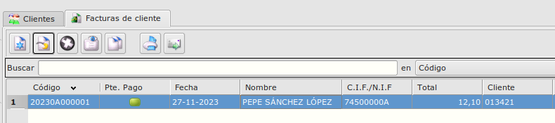

* Si pulsamos en el botón de enviar mail, se utilizará la plantilla de facturas y sutituirá las etiquetas que hemos incluido en los campos *Asunto* y *Cuerpo* de la plantilla por los datos de la factura:

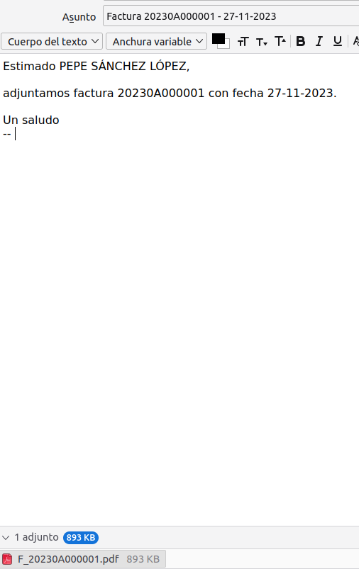

### Plantillas con formato

El formulario de la plantilla tiene tres pestañas que trabajan sobre el mismo texto del correo:

| Pestaña | Para qué sirve |
| --- | --- |
| **HTML** | Aquí se escribe o se pega el **código HTML** del texto del correo |
| **Cuerpo** | Muestra ese mismo texto ya con formato, para comprobar cómo quedará |
| **Ayuda** | Lista de etiquetas que se pueden usar (`%CLIENTE%`, `%CODIGO%`, `%FECHA%`...) |

* Si el código de la pestaña **HTML** empieza por `<html>`, el correo se envía con formato (negrita, colores, tamaños de letra). Por ejemplo:

```html
<html><body style="font-family: Arial, sans-serif; font-size: 14px;">
<p>Estimados Sres. de <b>%CLIENTE%</b>:</p>
<p>Les adjuntamos la factura <b>%CODIGO%</b> con fecha %FECHA%.</p>
<p>Para cualquier consulta sobre la misma pueden responder a este correo.</p>
<p>Atentamente,</p>
<p style="font-size:11px; color:#777777">Aquí el texto de protección de datos de la empresa.</p>
</body></html>
```

    . <b>texto</b>: pone el texto en negrita.
    . style="color:#1f4e79": cambia el color del texto.
    . style="font-size:11px": cambia el tamaño de letra.

* Tras guardar, en la pestaña **Cuerpo** se ve el resultado. En la ventana de envío el correo aparece con ese formato y se puede modificar el texto antes de enviar, pero no hay botones para cambiar el formato: el formato fijo se define en la plantilla.
* Si no empieza por `<html>`, el texto se envía tal cual, conservando los saltos de línea.
* Solo puede haber **una plantilla por tipo de documento**: el formulario no deja guardar una segunda.

### Firma, logo y texto de protección de datos

| Qué | Dónde se configura |
| --- | --- |
| Firma | Ficha de cada usuario, apartado **Envío mail**, campo *Firma pie correo*. Se añade sola al final de cada correo |
| Logo | Ficha de cada usuario, campo *Nombre (y ruta) de la imagen para firma correo*. La imagen tiene que estar en **el ordenador de cada usuario**, en esa ruta |
| Texto de protección de datos | Al final del código de la pestaña **HTML** de cada plantilla, como en el ejemplo anterior |

Con el envío directo desde Eneboo (tipo **Python**) el correo no pasa por Outlook ni Thunderbird: la firma y el texto legal que añadían esos programas hay que configurarlos aquí.


## Mensajes de aviso y error

| Mensaje | Causa | Qué hacer |
| --- | --- | --- |
| *No se ha podido enviar el correo. Error al adjuntar el fichero...* | No se pudo generar o encontrar el PDF | Revisar en **Empresa -> Envío mail** el directorio temporal: debe estar informado, existir, no tener espacios y el usuario debe poder escribir en él |
| *No se ha podido enviar el correo: no se puede crear el fichero temporal del correo (correo.txt)* | Ninguna de las carpetas probadas sirve (se listan en el mensaje) | Igual que el anterior; en Windows es habitual que la carpeta del usuario tenga espacios (`C:\Users\Nombre Apellido`) |
| *No se ha podido enviar el correo. ERROR - Error de autenticación SMTP* | Usuario o contraseña de correo incorrectos | Revisar la ficha del usuario; con Gmail, usar una contraseña de aplicación |
| *No se ha podido enviar el correo. ERROR - No se puede conectar al servidor SMTP* | Servidor, puerto o tipo de conexión incorrectos, o sin conexión a internet | Revisar los datos del servidor en la ficha del usuario |
| *Debe indicar al menos una dirección en 'Para'* | El campo Para está vacío | Escribir o añadir un destinatario |
| *Las siguientes direcciones no son válidas* | Alguna dirección está mal escrita | Corregir las direcciones indicadas |
| *Envío de email cancelado por el usuario* | Se pulsó Cancelar en la ventana | Nada; no se envía el correo |

Si el correo se envía sin errores pero no llega, comprobar la carpeta de correo no deseado del destinatario y la carpeta de enviados de la cuenta del usuario.


