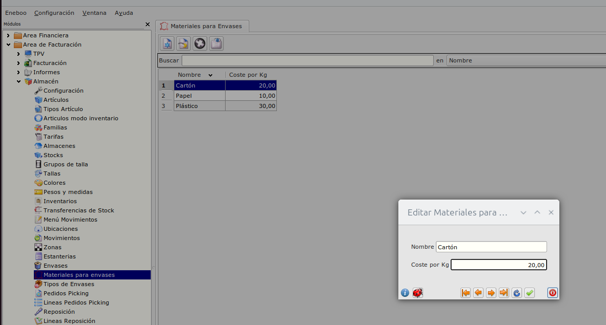
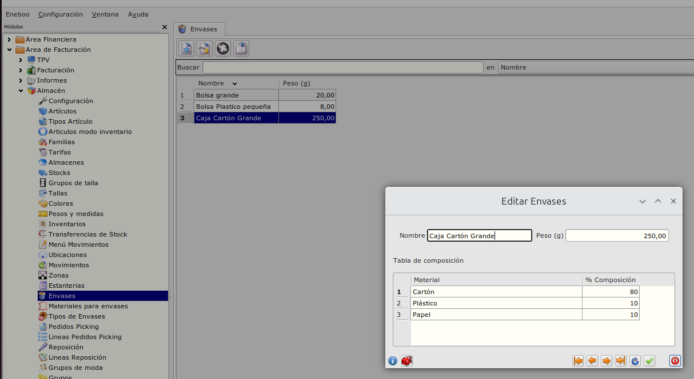
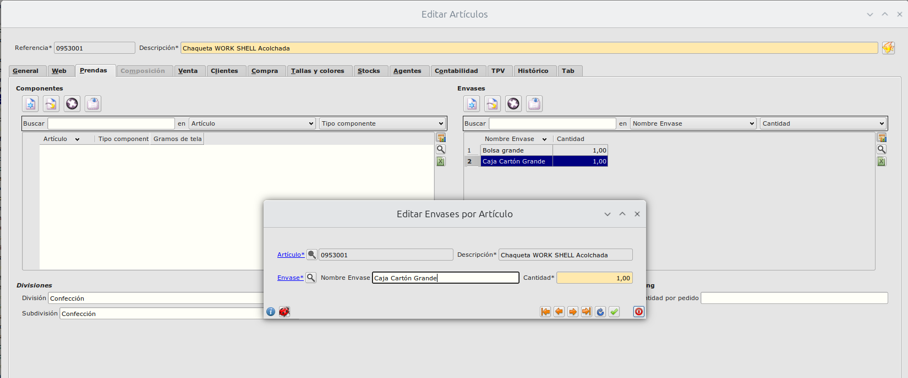
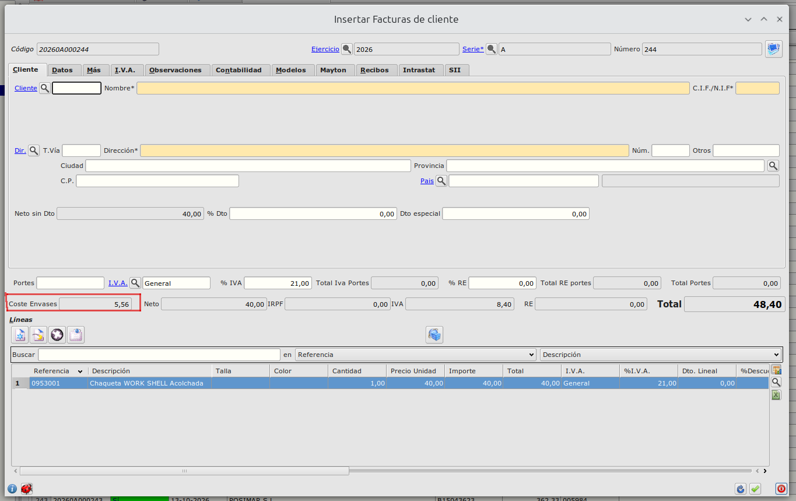
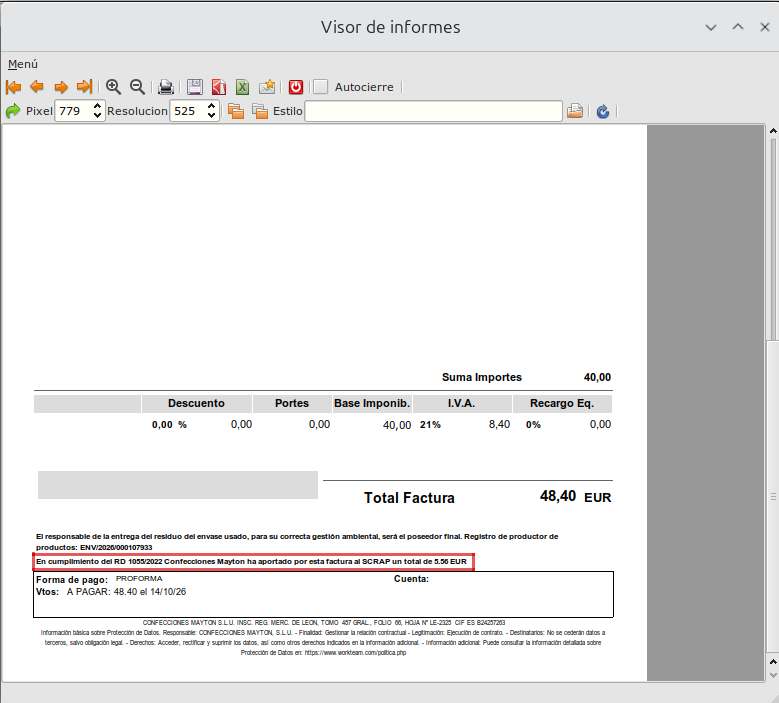

# Mayton
----------------------

## Materiales de Envases

Desde el Área de facturación -> Almacén -> Envases podemos dar de alta, editar y eliminar los materiales que comprondrán los envases

Para cada material informaremos el nombre y el Coste por cada Kg de peso.

## Envases

Desde el Área facturación -> Almacén -> Envases podemos dar de alta, editar y eliminar los envases que luego asociaremos a los artículos

Para cada envase informaremos el nombre y su peso en gramos.
Además en la tabla inferior informaremos el porcentaje de cada material que lo compone. La suma de todos los porcentajes debe ser siempre 100. Si es inferior y superior no podremos guardar la configuración.

NOTA: Al hacer doble click sobre el nombre de un material se informará de forma automática su porcentaje como el porcentaje restante para ese envase.

## Asociación de envases a artículos

En el formulario de edición de artículos, si abrimos la pestaña **Prendas** em la tabla de la derecha **Envases** podemos asociar al artículo sus envases correspondientes. Por defecto la cantidad de envses será 1 por cada tipo de envase, pero podríamos poner más.

## Cálculo de coste e informe de factura

En la cabecera de factura se ha incluido un nuevo valor **Coste Envases**. 

Este valor se calcula al crear una factura de cliente (tanto de forma manual como desde un albarán) cuyas líneas correspondan a artículos que tengan envases asociadas

Ese valor se calcula como la suma del cosste de los envases de todas sus líneas multiplicado por la cantdidad de cada línea.

Para cada línea el coste de envases será la suma de los costes de cada uno de los envases que el artículo tenga asociado.

El coste de cada envase será la suma del coste por Kg del material dividido entre 1000 multiplicado por el peso en gramos del envase multiplicado por el porcentaje del material en el envase.

En el informe de factura aparecerá ese importe en el pié

