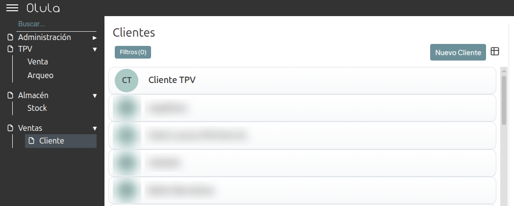
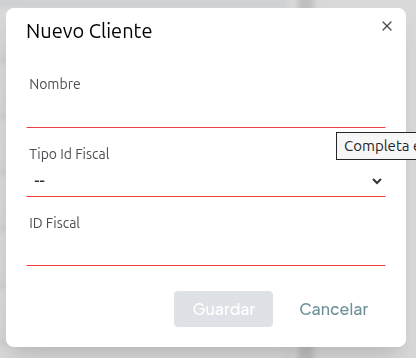
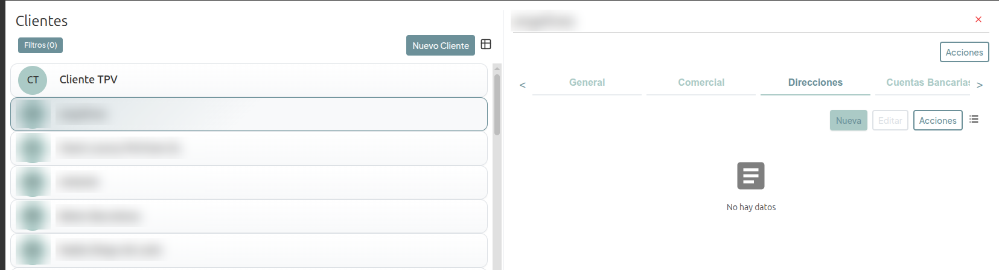
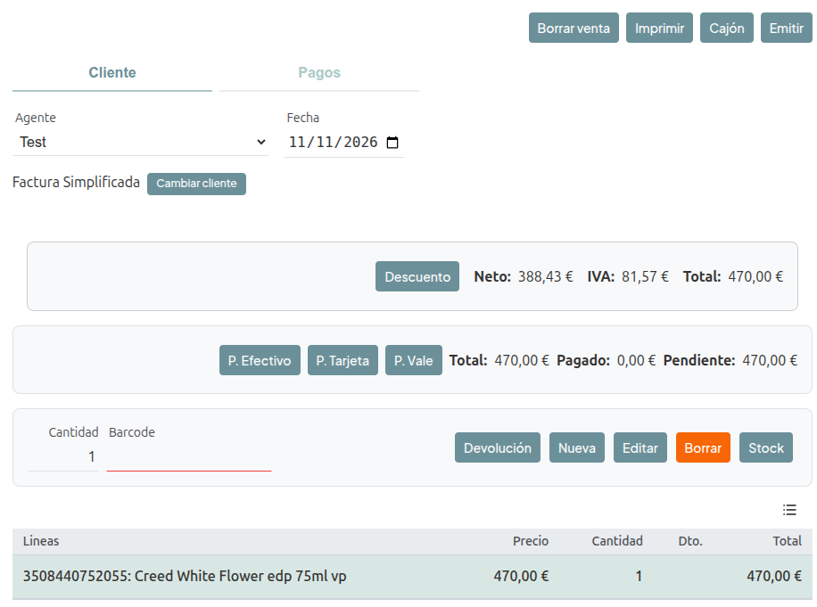
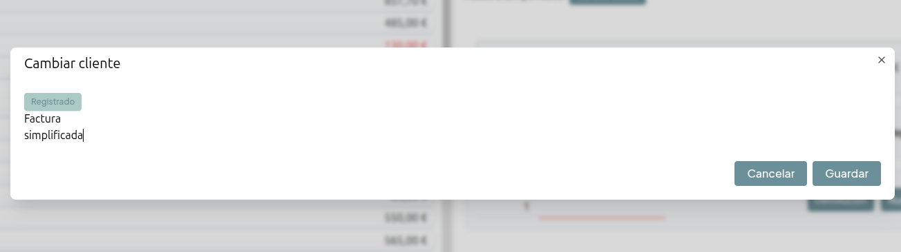
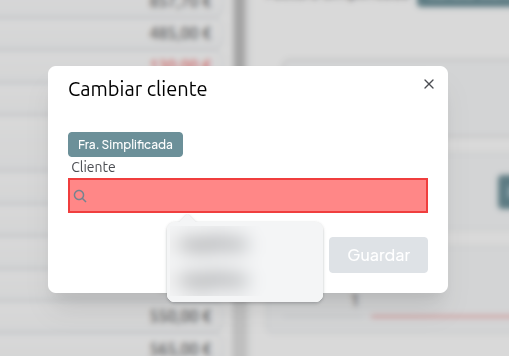
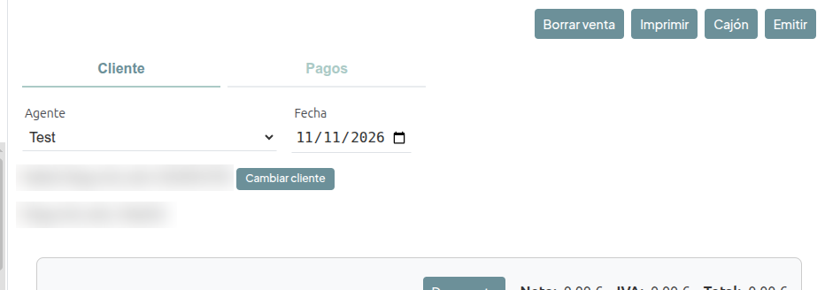

# Crear un cliente y cambiar el cliente de una venta TPV

## Precondiciones
Debemos tener acceso al menú *Ventas > Cliente* para crear clientes y al menú *TPV > Venta* para modificar las ventas.

## Crear un cliente

* Vamos a *Ventas > Cliente* y pulsamos el botón *Nuevo Cliente*.
    

* Se abre el formulario *Nuevo Cliente*. Rellenamos los campos, que son todos obligatorios:
    * *Nombre*: nombre o razón social del cliente.
    * *Tipo Id Fiscal*: seleccionamos *N.I.F.* para clientes españoles, *V.A.T.* para clientes intracomunitarios u *OTRO* para el resto.
    * *ID Fiscal*: número de identificación fiscal del cliente. Se recomienda introducir un nif válido de acuerdo al Tipo Id Fiscal establecido
    

* Pulsamos *Guardar*.
    * El botón *Guardar* no se activa hasta que todos los campos son válidos.
    * El cliente se crea y aparece en el listado de clientes.

### Crear una dirección del cliente

Para poder asignar el cliente a una venta TPV, el cliente debe tener al menos una dirección creada.

* En *Ventas > Cliente* seleccionamos el cliente en el listado.
    * Se abre la ficha del cliente a la derecha.

* Vamos a la pestaña *Direcciones* y pulsamos el botón *Nueva*.
    

* Rellenamos los datos de la dirección:
    * *Tipo de Vía*, *Nombre de la Vía*, *Número*, *Otros*, *Apdo. Correos*, *Cód. Postal*, *Ciudad*, *Provincia*, *País* y *Teléfono*.
    * Los campos *Nombre de la Vía* y *Ciudad* y *País* son obligatorios.

* Pulsamos *Guardar*.
    * La dirección aparece en el listado de direcciones del cliente.

## Cambiar el cliente de una venta no pagada

> **Importante:** para poder cambiar el cliente de una venta, el nuevo cliente debe tener creada una dirección. Si no la tiene, debemos crearla antes como se indica en el apartado [Crear una dirección del cliente](#crear-una-dirección-del-cliente).

Solo se puede cambiar el cliente mientras la venta está abierta, es decir, mientras no se ha emitido. Cuando la venta se paga por completo, se emite automáticamente y ya no se puede cambiar el cliente.

* Vamos a *TPV > Venta* y seleccionamos la venta.

* En la pestaña *Cliente* se muestra el cliente actual de la venta (o *Factura Simplificada* si no tiene). Pulsamos el botón *Cambiar cliente*.
    
    * Si el botón *Cambiar cliente* está deshabilitado, la venta ya está emitida y no se puede modificar.

* Se abre el formulario *Cambiar cliente*.
    

* Para asignar un cliente registrado:
    * Si el formulario muestra *Factura simplificada*, pulsamos el botón *Registrado*.
    * En el campo *Cliente* escribimos parte del nombre y lo seleccionamos de la lista.
    
    * Si el cliente no existe, debemos crearlo antes como se indica en el apartado [Crear un cliente](#crear-un-cliente), junto con su dirección.

* Para quitar el cliente y dejar la venta como factura simplificada:
    * Pulsamos el botón *Fra. Simplificada*.

* Pulsamos *Guardar*.
    * La venta se actualiza con el nuevo cliente y su dirección.
    
    * La serie de facturación de la venta cambia automáticamente: con cliente registrado se usa la serie de facturas nominativas y sin cliente la serie de facturas simplificadas. Por lo tanto es importante que el CIF/NIF del cliente sea correcto.

* Una vez cambiado el cliente, podemos continuar con el cobro de la venta.
