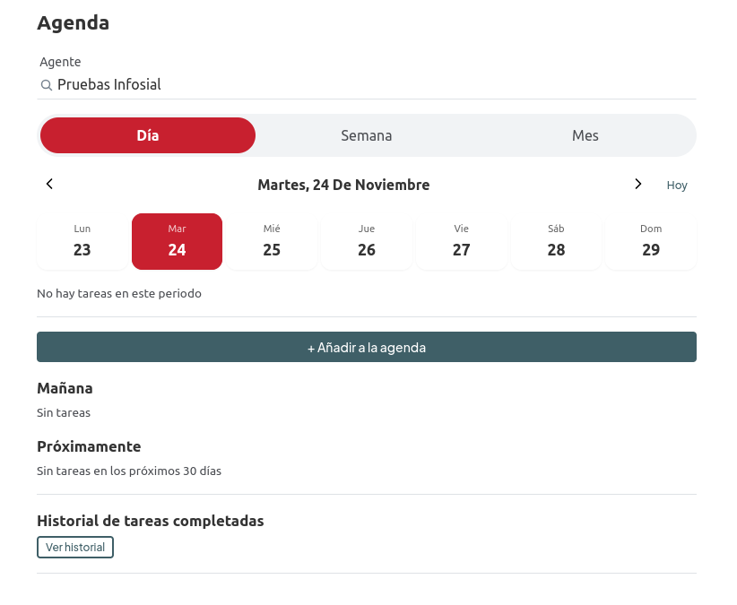
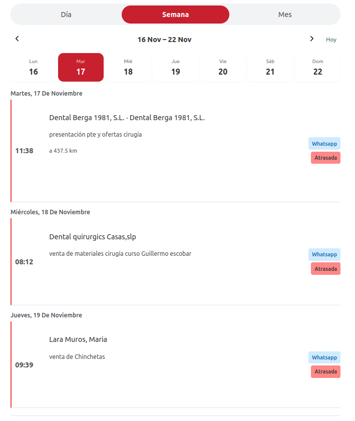
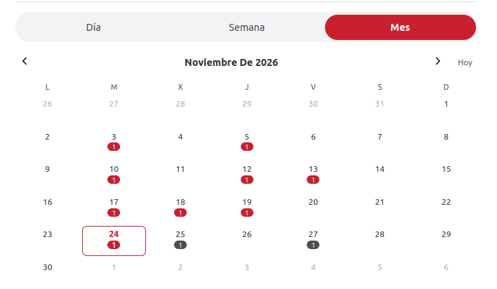
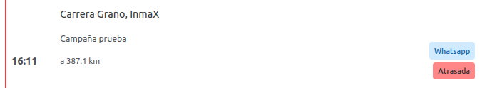
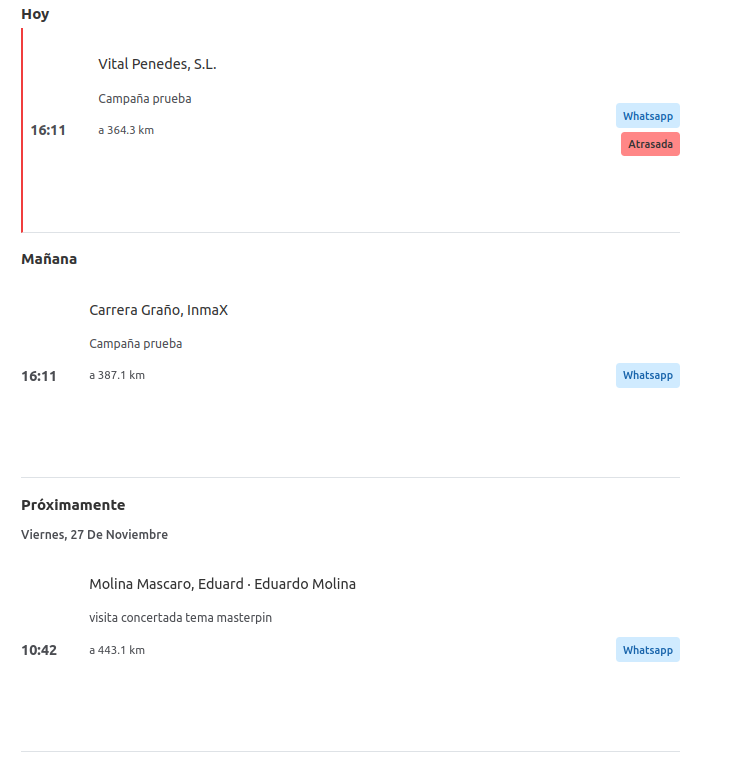

# Agenda

---

La **Agenda** muestra las tareas y visitas pendientes del comercial por día, semana o mes, junto con lo que tiene en los próximos días. Se abre con el botón **Agenda** de la barra inferior.

<!-- CAPTURA agenda.png: ivanespinosa, /ss/mi-agenda, vista Día de hoy con varias tareas y la ubicación del navegador permitida (para que salga la distancia). Pantalla completa o la parte superior. -->

## Qué tareas aparecen

La Agenda muestra las tareas **pendientes** (no completadas) del agente: las de sus tratos abiertos, las tareas sin trato y las de incidencias. Las tareas de tratos ya ganados o perdidos no aparecen. Cuando una tarea se completa, desaparece de la Agenda y pasa al **historial** (ver más abajo).

Una visita que se inició y no se finalizó el mismo día se da por **finalizada automáticamente** al día siguiente, con la hora de fin igual a la de inicio.

Los supervisores pueden ver la agenda de otro agente con el campo **Agente** (ver [Ver los datos de otro agente](./navegacion.md#ver-los-datos-de-otro-agente)).

## Vistas: día, semana y mes

Las pestañas **Día**, **Semana** y **Mes** cambian el periodo que se muestra. Debajo:

- las flechas **‹** y **›** pasan al día, semana o mes anterior o siguiente;
- en el centro aparece el periodo que estamos viendo (por ejemplo "lunes, 24 de noviembre", "24 nov – 30 nov" o "noviembre de 2026");
- el botón **Hoy** vuelve al día actual.

### Día y semana

<!-- CAPTURA agenda_semana.png: vista Semana de la semana actual, con la tira de días y tareas en varios días. -->

Encima de la lista hay una **tira con los siete días de la semana** (de lunes a domingo). El día de hoy aparece destacado y el día elegido, marcado. Al pulsar un día se abre la vista **Día** de ese día.

Las tareas se agrupan por día y, dentro de cada día, por hora. Cada tarea se muestra con la misma tarjeta que en la pantalla Hoy (ver [Tareas de hoy](./hoy.md#tareas-de-hoy)): hora, cliente y contacto, título, tipo y estado (**Atrasada** o **En curso**). Al pulsarla se abre la tarea, desde donde se puede iniciar, completar o editar.

### Mes

<!-- CAPTURA agenda_mes.png: vista Mes del mes actual, con días que tengan tareas (si puede ser, alguno con atrasadas, en rojo). -->

Calendario del mes, de lunes a domingo. Cada día con tareas pendientes muestra un **contador** con el número de tareas; si alguna está atrasada, el contador aparece en **rojo**. Los días de otros meses se ven atenuados y el día de hoy, destacado.

Al pulsar un día se abre la vista **Día** de ese día.

### Periodos con muchas tareas

Cada vista carga como máximo **800 tareas**. Si el periodo tiene más, aparece un aviso indicando que solo se muestran las primeras y que conviene elegir una vista más corta (por ejemplo, Semana en lugar de Mes).

## Distancia a cada cliente

Si el navegador tiene permiso para usar la **ubicación**, cada tarea de un cliente muestra debajo del título la distancia **en línea recta** desde donde está el comercial hasta la dirección de facturación del cliente, por ejemplo "a 12,4 km". No es la distancia por carretera.

La distancia solo aparece si la dirección del cliente está geolocalizada. Si el navegador no da la ubicación, aparece el aviso "Activa la ubicación del navegador para ver la distancia a cada cliente".

<!--  -->
<!-- CAPTURA agenda_distancia.png: recorte de una o dos tarjetas de tarea en la Agenda con el texto "a N km". -->

## Añadir a la agenda

El botón **+ Añadir a la agenda** abre la pantalla de nueva visita o tarea. También se puede crear desde el botón **+** de la barra inferior.

## Hoy, mañana y próximamente

<!-- CAPTURA agenda_proximas.png: recorte de la tarjeta con los bloques "Mañana" y "Próximamente". -->

Debajo del calendario hay un resumen de lo que viene, siempre a partir de hoy e independiente de la vista elegida arriba:

- **Hoy**: las tareas pendientes de hoy. Este bloque no aparece cuando la vista de arriba ya es el día de hoy.
- **Mañana**: las de mañana.
- **Próximamente**: las de los **30 días siguientes**, agrupadas por día.

## Historial de tareas completadas

Al final de la pantalla, el botón **Ver historial** muestra las tareas completadas del agente, agrupadas por día y de la más reciente a la más antigua. Se cargan de **30 en 30**: el botón **Cargar más** trae las 30 anteriores. Al pulsar una se abre la tarea, ya completada.

[Volver al Índice](./index.md)
