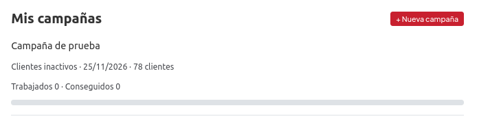
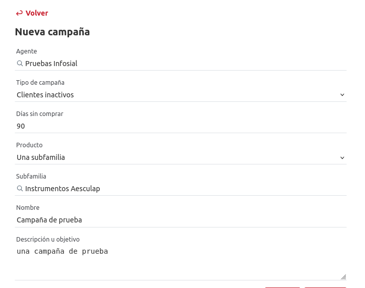
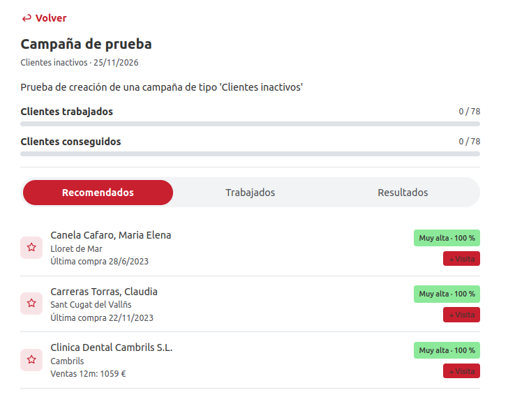

# Campañas

---

Una **campaña** es una acción comercial dirigida a un grupo de clientes del comercial, elegidos con un criterio: los que han dejado de comprar un producto, los que compran unos artículos pero no otros, o los que tienen más afinidad con un producto. Al crearla se genera un **trato para cada cliente**, y desde la campaña se sigue cuántos se han trabajado, cuántos se han conseguido y cuánto se ha vendido.

Se abre con el botón **Campañas** de la barra inferior.

## Mis campañas

<!-- CAPTURA campanias.png: ivanespinosa, /ss/mis-campanias, con alguna campaña creada. -->

La lista de campañas del comercial, de la más reciente a la más antigua. Los supervisores pueden ver las de otro agente con el campo **Agente**.

Cada campaña muestra su nombre, su tipo, su fecha de creación y su número de clientes, y debajo:

- **Trabajados**: clientes cuyo trato ya se ha cerrado (ganado o perdido).
- **Conseguidos**: clientes cuyo trato se ha ganado.
- Una barra con el porcentaje de clientes trabajados.

Al pulsar una campaña se abre su [detalle](#detalle-de-la-campaña). El botón **+ Nueva campaña** abre el alta.

## Nueva campaña

<!-- CAPTURA nueva_campania.png: /ss/mis-campanias/nueva con el tipo "Venta cruzada" y artículos añadidos. -->

Se abre con **+ Nueva campaña** o con la opción **Nueva campaña** del botón **+** de la barra inferior. Los supervisores pueden crearla para otro agente eligiéndolo en el campo **Agente**: la campaña y sus tratos serán de ese agente.

Primero se elige el **Tipo de campaña**; según el tipo, se piden unos datos u otros. Al cambiar de tipo se vacían los datos del tipo anterior (se conservan el nombre y la descripción).

### Clientes inactivos

Para recuperar clientes que han dejado de comprar un producto.

| Campo                | Qué es                                                                                                       |
| -------------------- | ------------------------------------------------------------------------------------------------------------ |
| **Días sin comprar** | Entran los clientes que han comprado alguna vez el producto, pero no en los últimos N días. Por defecto, 90. |
| **Producto**         | **Una subfamilia** o **Unos artículos**.                                                                     |

### Venta cruzada

Para ofrecer a quien ya compra unos artículos otros que no compra.

| Campo                            | Qué es                                                                   |
| -------------------------------- | ------------------------------------------------------------------------ |
| **Compras desde** / **Hasta**    | El periodo de compra que se tiene en cuenta. Por defecto, el último año. |
| **Compran estos artículos**      | Los artículos que deben haber comprado en ese periodo.                   |
| **Deben haber comprado**         | **Alguno de ellos** o **Todos**.                                         |
| **Y no compran estos artículos** | Opcional: los artículos que se les quieren ofrecer.                      |
| **Quedan fuera si compraron**    | **Alguno de ellos** o **Todos** los anteriores.                          |

### Afinidad a un producto

Para captar a los clientes con más probabilidad de interesarse por un producto según el modelo de recomendación.

| Campo                   | Qué es                                                                                                                         |
| ----------------------- | ------------------------------------------------------------------------------------------------------------------------------ |
| **Afinidad mínima (%)** | Entran los clientes con al menos esta afinidad con el producto. Por defecto, 70 %. Ver [Afinidad](./mapa.md#afinidad).         |
| **Producto**            | **Una subfamilia** o **Unos artículos**. Al buscar artículos solo aparecen los que tienen datos en el modelo de recomendación. |

### Datos comunes

| Campo                      | Qué es                                    |
| -------------------------- | ----------------------------------------- |
| **Nombre**                 | Obligatorio, hasta 100 caracteres.        |
| **Descripción u objetivo** | Opcional: qué se pretende con la campaña. |

En todos los tipos solo entran **clientes del agente** (los suyos y aquellos en los que figura como uno de sus agentes) y nunca los marcados en el ERP como **excluidos de campañas**.

### Ver los clientes antes de crearla

**Ver clientes** muestra la lista de clientes que entrarían en la campaña (en las de afinidad, con su afinidad, de mayor a menor), con el aviso de que se creará un trato para cada uno:

- **Modificar filtros** (o el botón **Volver** de arriba) vuelve al formulario sin perder lo rellenado.
- **Crear campaña** la crea y abre su detalle.

No se puede crear una campaña sin clientes.

### Qué se crea

Al crear la campaña se da de alta un **trato publicado** por cada cliente, a nombre del agente de la campaña. Estos tratos aparecen en la lista de [Tratos](./tratos.md) con la etiqueta **CAMPAÑA**, y se trabajan como cualquier otro: tareas, presupuesto, pedido, ganado o perdido.

## Detalle de la campaña

<!-- CAPTURA campania.png: el detalle de una campaña, pestaña Recomendados, con las barras de trabajados y conseguidos. -->

Arriba aparecen el nombre, el tipo, la fecha de creación y la descripción, y dos barras:

- **Clientes trabajados**: clientes con el trato cerrado (ganado o perdido) / total de clientes.
- **Clientes conseguidos**: clientes con el trato ganado / total de clientes.

Debajo, tres pestañas:

| Pestaña          | Qué muestra                                                                                                                                                                                                                                                                                                                                                                  |
| ---------------- | ---------------------------------------------------------------------------------------------------------------------------------------------------------------------------------------------------------------------------------------------------------------------------------------------------------------------------------------------------------------------------- |
| **Recomendados** | Los clientes **pendientes de trabajar** (trato abierto), de mayor a menor afinidad. Cada uno muestra su ciudad, la distancia desde donde está el comercial (si el navegador da la ubicación), sus ventas de 12 meses (o su última compra) y su afinidad. El botón **+ Visita** abre [Nueva tarea](./nueva_tarea.md) con el cliente y **su trato de la campaña** ya elegidos. |
| **Trabajados**   | Los clientes con el trato ya ganado o perdido, con su estado.                                                                                                                                                                                                                                                                                                                |
| **Resultados**   | Lo facturado a los clientes de la campaña **desde su fecha de creación** en los productos de la campaña (la subfamilia o los artículos), en total y por cliente, de mayor a menor.                                                                                                                                                                                           |

Al pulsar el nombre de un cliente se abre su [ficha](./clientes.md#ficha-de-cliente).

[Volver al Índice](./index.md)
