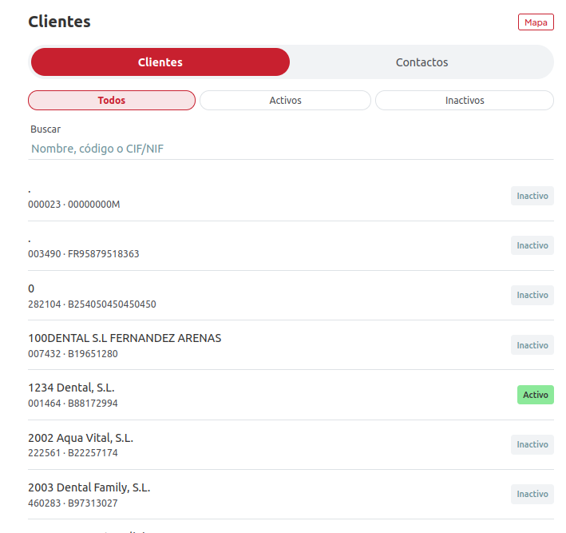
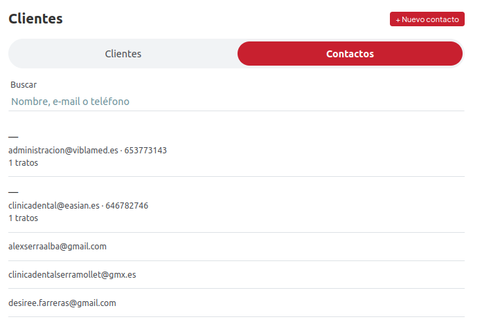
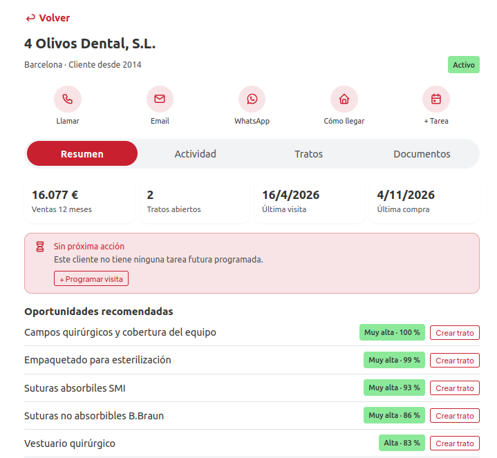
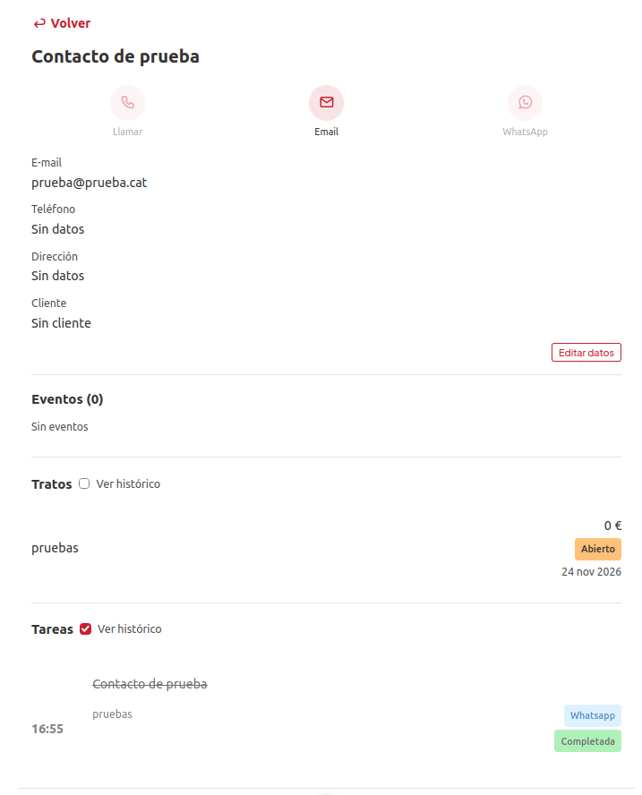

# Clientes y contactos

---

Desde el botón **Clientes** de la barra inferior se consultan los clientes y los contactos del comercial, y se abre la ficha de cada uno.

## Lista de clientes y contactos

La pantalla tiene dos pestañas:

- **Clientes**: los clientes del comercial (aquellos de los que es agente, o en los que figura como uno de sus agentes). Los supervisores ven también los de su equipo. Cada cliente muestra su nombre, su código, su CIF/NIF y si está **Activo** (ver [Cliente activo](#cliente-activo)). Al pulsar uno se abre su [ficha](#ficha-de-cliente). Arriba a la derecha, el botón **Mapa** abre el [mapa de clientes](./mapa.md).

<!-- CAPTURA clientes.png: ivanespinosa, /ss/mis-clientes, pestaña Clientes, con algún texto en "Buscar". -->

- **Contactos**: los contactos con e-mail que son del comercial (o de su equipo, para los supervisores), que están en su lista de contactos o con los que tiene tratos. Cada uno muestra su nombre, su e-mail y su teléfono y, si los tiene, el número de **tratos abiertos**. Al pulsar uno se abre su [ficha](#ficha-de-contacto). Arriba a la derecha, el botón **+ Nuevo contacto** abre el alta de contacto.

<!-- CAPTURA clientes.png: ivanespinosa, /ss/mis-clientes, pestaña Clientes, con algún texto en "Buscar". -->

En la pestaña **Clientes**, los botones **Todos**, **Activos** e **Inactivos** filtran la lista por estado (ver [Cliente activo](#cliente-activo)). Al entrar aparece marcado **Todos**, para que la búsqueda encuentre cualquier cliente.

El campo **Buscar** filtra mientras se escribe: en **Clientes**, por **nombre, código o CIF/NIF**; en **Contactos**, por **nombre, e-mail o teléfono** (basta con una parte de cualquiera de ellos). Las dos listas aparecen **por orden alfabético** y se cargan de 50 en 50: el botón **Cargar más**, al final, trae los siguientes.

## Ficha de cliente

<!-- CAPTURA ficha_cliente.png: la ficha de un cliente de ivanespinosa, pestaña Resumen, con las casillas y las oportunidades recomendadas. -->

Arriba aparecen el **nombre** del cliente, su **ciudad**, el año desde el que es **cliente** y la etiqueta **Activo** o **Inactivo**.

### Acciones

Cinco accesos directos con icono: **Llamar** y **WhatsApp** (al teléfono del cliente), **Email**, **Cómo llegar** (abre la dirección de facturación en el mapa del dispositivo) y **+ Tarea**, que abre [Nueva tarea](./nueva_tarea.md) con el cliente ya elegido. Los que no tienen dato (por ejemplo, sin teléfono) aparecen atenuados.

### Resumen

| Dato                | Qué expresa                                                                                                                                                                                                               |
| ------------------- | ------------------------------------------------------------------------------------------------------------------------------------------------------------------------------------------------------------------------- |
| **Ventas 12 meses** | Lo facturado al cliente en los últimos 12 meses (por cualquier agente), solo de las familias de productos que cuentan para la previsión. Solo se muestra si el cliente es de uno de los agentes que el usuario puede ver. |
| **Tratos abiertos** | Número de tratos abiertos con el cliente.                                                                                                                                                                                 |
| **Última visita**   | Fecha de la última visita completada con el cliente, de cualquier comercial (también las de incidencias).                                                                                                                 |
| **Última compra**   | Fecha del último pedido del cliente.                                                                                                                                                                                      |

Si el cliente **no tiene ninguna tarea futura**, aparece el aviso **"Sin próxima acción"** con el botón **+ Tarea**.

**Oportunidades recomendadas**: las subfamilias de productos que el modelo de recomendación considera más afines al cliente, con su nivel de afinidad. El botón **Crear trato** abre el [alta de trato](./tratos.md#nuevo-trato) con el cliente y esa subfamilia ya elegidos.

#### Cliente activo

Un cliente está **activo** si no está dado de baja y ha hecho algún pedido en los últimos meses (12 por defecto; el número de meses se configura en la empresa). **Cliente desde** es el año de alta del cliente o, si no consta, el de su primer pedido.

### Actividad

Las tareas con el cliente, pendientes y completadas, de la más reciente a la más antigua (hasta 50), con la misma tarjeta que en la Agenda.

### Tratos

Los tratos del cliente, de cualquier estado, con la [tarjeta de trato](./tratos.md#la-lista) (hasta 50).

### Documentos

Los últimos **presupuestos**, **pedidos** y **facturas** del cliente (hasta 20 de cada), con su código, fecha e importe total. Los presupuestos tienen además un botón **PDF** para abrirlos.

## Ficha de contacto

<!-- CAPTURA ficha_contacto.png: la ficha de un contacto de la lista de ivanespinosa, con datos, eventos, tratos y tareas. -->

Arriba aparecen el **nombre** del contacto y los accesos **Llamar**, **Email** y **WhatsApp**.

### Datos

**E-mail**, **Teléfono**, **Dirección** y **Cliente** al que pertenece (con enlace a su ficha). Con **Editar datos** se pueden cambiar el nombre, el teléfono, la dirección, la ciudad, el código postal y el cliente.

Los usuarios con permiso para revisar contactos ven además la casilla **Contacto revisado**, para marcar que sus datos están comprobados.

### Eventos

Los cursos y eventos en los que ha participado el contacto, con su fecha.

### Tratos y tareas

Los **tratos** y las **tareas** del contacto que son del comercial conectado. Por defecto solo los abiertos y las pendientes; con la casilla **Ver histórico** se muestran también los cerrados y las completadas.

### Notas

Notas libres sobre el contacto. Se escribe en **Nueva nota** y se pulsa **Añadir nota**.

### Contactos que no están en la lista del comercial

Si el contacto **no está en la lista de contactos del comercial**, la ficha muestra sus datos, sus eventos y sus notas, pero no sus tratos ni sus tareas, no se pueden añadir notas y no se puede cambiar su cliente ni borrarlo. Los usuarios de marketing ven siempre la ficha completa.

### Borrar el contacto

**Borrar contacto** (con confirmación) lo elimina definitivamente. Solo aparece si el contacto está en la lista del comercial.

## Nuevo contacto

Se abre con **+ Nuevo contacto** en la pestaña Contactos o con la opción **Nuevo contacto** del botón **+** de la barra inferior. Tiene los mismos campos que el alta de contacto desde un trato (ver [Crear un contacto nuevo](./tratos.md#crear-un-contacto-nuevo)): nombre y e-mail obligatorios (comprobando que el e-mail no exista ya), teléfono, dirección, código postal y cliente. Al crearlo se abre su ficha.

[Volver al Índice](./index.md)
