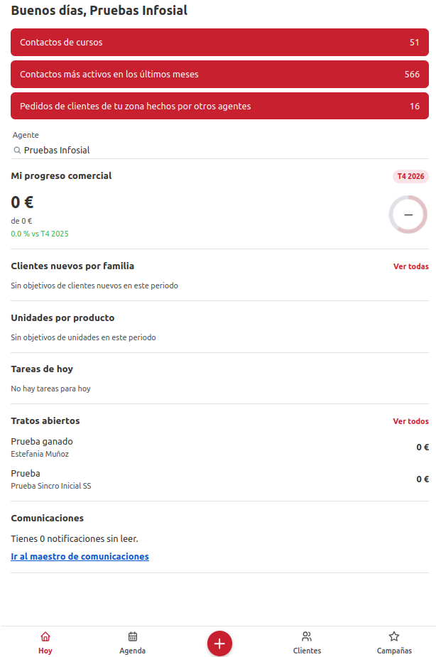
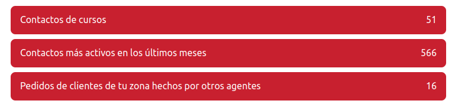
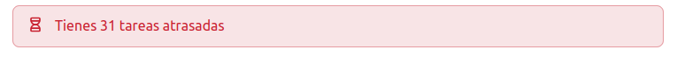
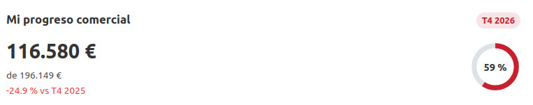
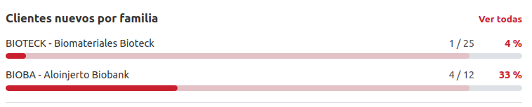
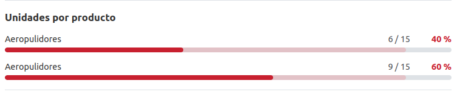
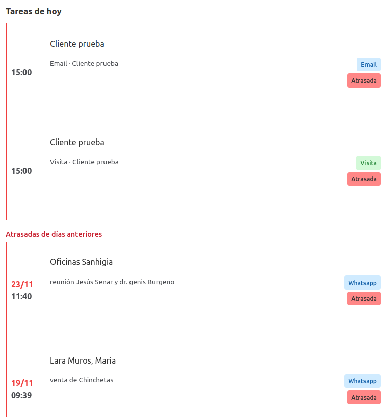
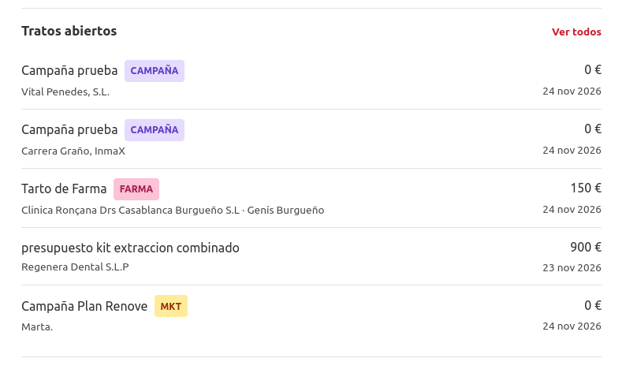

# Hoy

---

**Hoy** es la pantalla de inicio de SmartSales: reúne lo que el comercial necesita ver al empezar el día. Se abre al entrar en SmartSales y con el botón **Hoy** de la barra inferior.

<!-- CAPTURA hoy.png: ivanespinosa, /ss/dashboard, con su propio agente. Pantalla completa (si no cabe, la parte superior: saludo, avisos, aviso de atrasadas y "Mi progreso comercial"). -->

De arriba abajo, la pantalla tiene estas partes.

## Saludo

"Buenos días/tardes/noches", seguido del nombre del comercial conectado.

## Avisos

Tres accesos con un contador cada uno. Al pulsar uno se abre la lista correspondiente.

| Aviso                                                       | Qué cuenta                                                                                                                                           |
| ----------------------------------------------------------- | ---------------------------------------------------------------------------------------------------------------------------------------------------- |
| **Contactos de cursos**                                     | Contactos que han participado recientemente en cursos o eventos y que son de la zona del comercial (sus códigos postales) o no tienen código postal. |
| **Contactos más activos en los últimos meses**              | Contactos del comercial con más actividad en los últimos meses.                                                                                      |
| **Pedidos de clientes de tu zona hechos por otros agentes** | Pedidos recientes, asociados a cursos o eventos, de clientes de la zona del comercial que ha hecho otro agente.                                      |

Los avisos son siempre los del **comercial conectado**, aunque un supervisor haya elegido otro agente en el campo **Agente**.

<!-- CAPTURA hoy_avisos.png: recorte de los tres avisos con sus contadores (ivanespinosa). -->

## Aviso de tareas atrasadas

Si hay tareas atrasadas aparece el aviso **"Tienes N tareas atrasadas"**. Al pulsarlo se abre la lista de [tareas atrasadas](./tareas_atrasadas.md).

El número suma:

- las tareas pendientes **de hoy** cuya hora ya ha pasado, y
- las tareas pendientes de **días anteriores**, de los **últimos 90 días**.

Una tarea de hoy sin hora no se cuenta como atrasada hasta el día siguiente. Las tareas de hace más de 90 días no se suman aquí; se pueden consultar desde la lista de [tareas atrasadas](./tareas_atrasadas.md).

<!-- CAPTURA hoy_aviso_atrasadas.png: recorte del aviso "Tienes N tareas atrasadas" (ivanespinosa u otro comercial que tenga atrasadas). -->

## Agente

Solo para supervisores: el campo **Agente** permite ver los datos de otro agente en el resto de la pantalla (progreso, indicadores, tareas y tratos). Ver [Ver los datos de otro agente](./navegacion.md#ver-los-datos-de-otro-agente).

## Mi progreso comercial

<!-- CAPTURA hoy_progreso.png: recorte de la tarjeta "Mi progreso comercial" con el círculo (ivanespinosa, trimestre actual). -->

Resumen de las ventas del **trimestre actual** (indicado arriba a la derecha, por ejemplo "T4 2026"). Son las mismas cifras que la tarjeta "Ventas del periodo" de [Rendimiento](./rendimiento.md#ventas-del-periodo) con ese trimestre elegido.

| Dato                             | Qué expresa                                                                                                                                                                                             |
| -------------------------------- | ------------------------------------------------------------------------------------------------------------------------------------------------------------------------------------------------------- |
| **Cifra grande**                 | Ventas realizadas en el trimestre hasta hoy. **Al pulsarla se abre [Rendimiento](./rendimiento.md)**.                                                                                                   |
| **"de X €"**                     | El objetivo de ventas del trimestre.                                                                                                                                                                    |
| **± % vs T4 2025** (por ejemplo) | Variación respecto al mismo tramo de fechas del mismo trimestre del año anterior: en verde si sube, en rojo si baja.                                                                                    |
| **Círculo**                      | Porcentaje del objetivo conseguido (relleno oscuro y cifra del centro) frente al tiempo transcurrido del trimestre (relleno claro). Ver [Indicador de progreso](./navegacion.md#indicador-de-progreso). |

## Clientes nuevos por familia

<!-- CAPTURA hoy_clientes_nuevos.png: recorte de la tarjeta "Clientes nuevos por familia" con varias líneas (ivanespinosa). -->

Objetivos de **captación de clientes nuevos** del comercial. Se configuran en el ERP, en los [KPIs por agente](../../sh_kpiagentes/sh_kpiagentes.md#kpi-nuevos-clientes): para cada periodo, qué **familias** (y opcionalmente qué **subfamilias**) se siguen, cuántos clientes nuevos hay que conseguir en cada una y, si se quiere, un **importe mínimo** de compra. Aquí solo aparecen esas familias o subfamilias, las del periodo de KPIs del comercial que incluye el día de hoy. El enlace **Ver todas** abre la pantalla de Objetivos.

Para cada familia o subfamilia:

| Dato           | Qué expresa                                                                          |
| -------------- | ------------------------------------------------------------------------------------ |
| **Nombre**     | Código y nombre de la familia o subfamilia.                                          |
| **A / B**      | A: clientes nuevos conseguidos. B: clientes nuevos que hay que conseguir (objetivo). |
| **Porcentaje** | A entre B, en %.                                                                     |
| **Barra**      | Porcentaje conseguido frente al tiempo transcurrido del periodo de objetivos.        |

Para cada familia o subfamilia configurada en el KPI, un **cliente nuevo** es un cliente al que el comercial le ha facturado productos de esa familia (o subfamilia) durante el periodo del KPI y al que **nunca antes le había facturado** productos de ella. Si el KPI tiene un importe mínimo, el cliente solo cuenta cuando lo que se le ha facturado de esa familia en el periodo llega a ese importe.

Los conseguidos se calculan **en el momento** a partir de las facturas, así que pueden no coincidir con la "Cantidad alcanzada" que muestra el ERP si allí no se han vuelto a calcular los datos.

Las líneas aparecen **de menor a mayor porcentaje**, para que lo que va más retrasado quede arriba. Si el comercial no tiene objetivos de este tipo en el periodo actual, se indica "Sin objetivos de clientes nuevos en este periodo".

## Unidades por producto

<!-- CAPTURA hoy_unidades.png: recorte de la tarjeta "Unidades por producto" con varias líneas (ivanespinosa). -->

Objetivos de **unidades vendidas** de productos concretos. También se configuran en los [KPIs por agente](../../sh_kpiagentes/sh_kpiagentes.md#kpi-cantidad-de-unidades): cada línea tiene un nombre, la lista de referencias de artículos que cuenta y las unidades objetivo. Se usa el mismo periodo de KPIs que en "Clientes nuevos por familia".

| Dato           | Qué expresa                                                                                                 |
| -------------- | ----------------------------------------------------------------------------------------------------------- |
| **Nombre**     | Nombre de la línea en el KPI.                                                                               |
| **A / B**      | A: unidades de las referencias de la línea facturadas por el comercial en el periodo. B: unidades objetivo. |
| **Porcentaje** | A entre B, en %.                                                                                            |
| **Barra**      | Porcentaje conseguido frente al tiempo transcurrido del periodo de objetivos.                               |

También aparecen de menor a mayor porcentaje, y las unidades se calculan en el momento a partir de las facturas.

## Tareas de hoy

<!-- CAPTURA hoy_tareas.png: recorte de la tarjeta "Tareas de hoy" con alguna tarea de hoy y, si es posible, la parte "Atrasadas de días anteriores" y el enlace "Ver las N atrasadas…". -->

Las tareas **pendientes** de hoy, ordenadas por hora. Solo aparecen las de tratos abiertos o sin trato; al completar una tarea desaparece de la lista.

Cada tarea se muestra en una tarjeta con:

- la **hora** (o "—" si no tiene);
- el **cliente y el contacto**, y debajo el título de la tarea;
- una etiqueta con el **tipo** (Visita, Llamada, Email o Whatsapp) y, si corresponde, otra con el **estado**: **Atrasada** (en rojo, si su hora ya ha pasado) o **En curso** (en naranja, si es una visita ya iniciada).

Al pulsar una tarea se abre su ficha, desde donde se puede iniciar la visita, completar la tarea o **editarla** (cambiar el título, el tipo, la fecha y la hora, el motivo, el producto o la nota) mientras esté pendiente.

Debajo, en **"Atrasadas de días anteriores"**, aparecen las **tres más recientes** de los últimos 90 días, con su fecha. Si hay más, el enlace **"Ver las N atrasadas de los últimos 90 días"** abre la lista completa.

## Tratos abiertos

<!-- CAPTURA hoy_tratos.png: recorte de la tarjeta "Tratos abiertos" (ivanespinosa). -->

Los **cinco tratos abiertos más recientes** del comercial (aquellos en los que es el responsable o figura como observador), del más nuevo al más antiguo.

Cada trato se muestra en una tarjeta, la misma que en la lista de Tratos y en las fichas de cliente y de contacto, con:

- el **título** y, si el trato viene de marketing, de farma o de una campaña del comercial, una etiqueta de color con su origen: **MKT** (amarilla), **FARMA** (rosa) o **CAMPAÑA** (violeta);
- el **cliente y el contacto** del trato;
- a la derecha, su **valor** y la **fecha** del trato.

En la lista de Tratos y en las fichas aparece además una etiqueta con el **estado**: Abierto, Ganado o Perdido. En Hoy no se muestra, porque todos están abiertos.

Al pulsar un trato se abre su detalle. El enlace **Ver todos** abre la lista completa de tratos.

## Comunicaciones

El número de **comunicaciones sin leer** del usuario conectado, con un enlace al listado de comunicaciones.

[Volver al Índice](./index.md)
