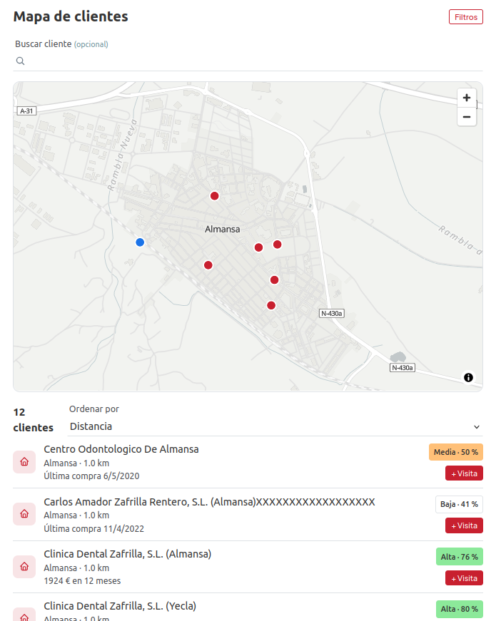
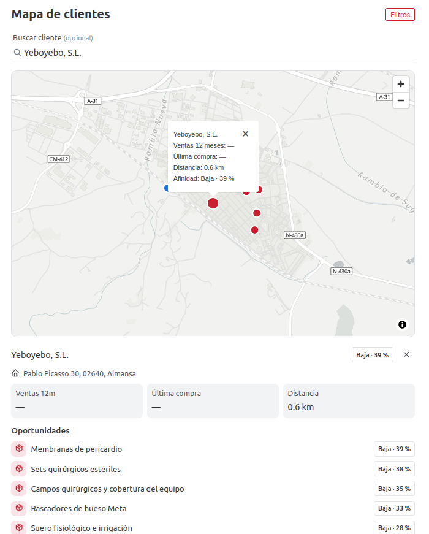
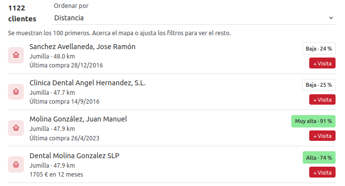
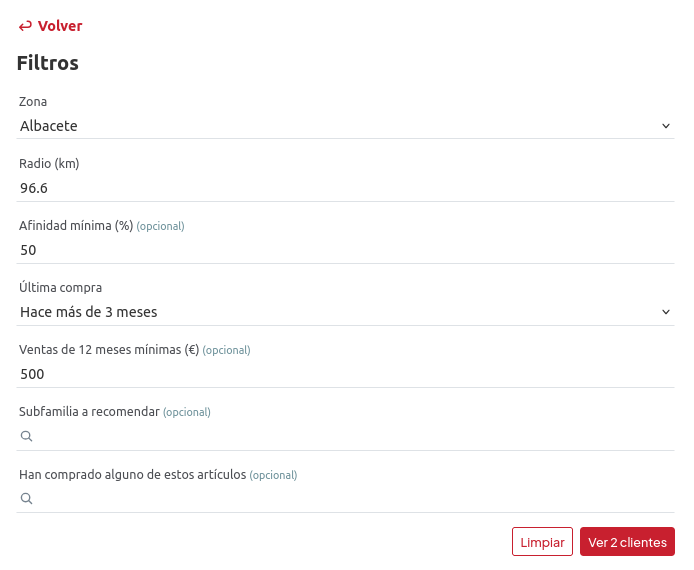
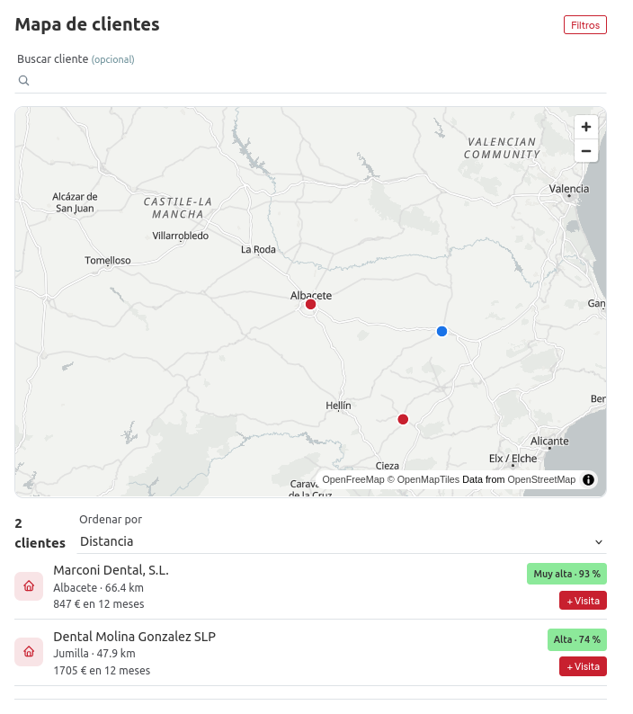

# Mapa de clientes y prospección

---

El **mapa de clientes** sitúa a los clientes del comercial alrededor de un punto, con sus ventas, su última compra, la distancia y su afinidad con los productos, para planificar visitas y buscar oportunidades. Con los **filtros de prospección** se buscan clientes concretos: por ejemplo, los que hace tiempo que no compran o los que tienen más afinidad con una subfamilia.

Se abre desde **Clientes**, con el botón **Mapa**.

<!-- CAPTURA mapa.png: ivanespinosa, /ss/mapa, con la ubicación permitida, varios pines y un cliente seleccionado (tarjeta debajo del mapa). -->

## Qué clientes aparecen

Aparecen los clientes del comercial (los suyos y aquellos en los que figura como uno de sus agentes) cuya **dirección de facturación está geolocalizada** y está dentro del **radio** de búsqueda alrededor del centro del mapa. Los clientes sin geolocalizar no se pueden situar en el mapa.

El **centro** de la búsqueda es, al entrar:

- la zona elegida en los filtros, si se viene de ellos;
- si no, la posición del comercial (si el navegador da permiso para usar la ubicación);
- si no, la última zona que se usó, o Madrid.

El **radio** por defecto es de **25 km**.

## El mapa

- Cada cliente es un **pin**. Al pulsarlo se abre una ventana con su nombre, sus **ventas de 12 meses**, su **última compra**, la **distancia** y su **afinidad**, y el cliente queda seleccionado (ver [Cliente seleccionado](#cliente-seleccionado)).
- La posición del comercial aparece marcada, si se conoce.
- Al **mover o acercar el mapa**, la búsqueda se repite con el nuevo centro y un radio que abarca la zona visible.

### Buscar un cliente

El campo **Buscar cliente**, encima del mapa, busca como la [lista de clientes](./clientes.md#lista-de-clientes-y-contactos): por **nombre, código o CIF/NIF**, sin distinguir tildes. Al elegir uno, el mapa se centra en él y queda seleccionado, aunque no esté entre los resultados de la búsqueda actual (por los filtros o por el límite de resultados). Si el cliente no está geolocalizado, no se puede mostrar.

## Cliente seleccionado

<!-- CAPTURA mapa_cliente.png: recorte de la tarjeta del cliente seleccionado, con las casillas, las oportunidades y los botones. -->

Debajo del mapa aparece una tarjeta con el cliente seleccionado:

| Dato                      | Qué expresa                                                                                                                      |
| ------------------------- | -------------------------------------------------------------------------------------------------------------------------------- |
| **Nombre** y **afinidad** | La afinidad del cliente (ver [Afinidad](#afinidad)).                                                                             |
| **Dirección**             | Su dirección de facturación.                                                                                                     |
| **Ventas 12m**            | Lo facturado al cliente en los últimos 12 meses, con el mismo criterio que en la [ficha de cliente](./clientes.md#resumen).      |
| **Última compra**         | La fecha de su último pedido.                                                                                                    |
| **Distancia**             | La distancia **en línea recta** desde donde está el comercial hasta el cliente. Si el navegador no da la ubicación, aparece "—". |
| **Oportunidades**         | Las subfamilias de productos más afines al cliente, con su nivel de afinidad.                                                    |

Los botones **Ver cliente** abren su [ficha](./clientes.md#ficha-de-cliente) y **+ Añadir visita** abre [Nueva tarea](./nueva_tarea.md) con el cliente ya elegido.

Para **deseleccionar** el cliente y cerrar la tarjeta, se pulsa la **×** de su esquina superior derecha, o la **×** de la ventana de su pin en el mapa. Al pulsar otro cliente (en el mapa o en la lista), la tarjeta pasa a mostrar ese.

## Lista de clientes

<!-- CAPTURA mapa_lista.png: recorte de la lista de clientes bajo el mapa, con el contador "N clientes" y el selector "Ordenar por". -->

Debajo, la lista de los clientes encontrados, con el número total arriba ("N clientes"). Se muestran como máximo los **100 primeros**; si hay más, se indica y conviene acercar el mapa o ajustar los filtros.

Cada cliente muestra su **ciudad** y su **distancia**, sus **ventas de 12 meses** (o, si no tiene, la fecha de su **última compra**), su **afinidad** y el botón **+ Visita**. Al pulsar el icono de la izquierda el cliente se selecciona en el mapa; al pulsar su nombre se abre su ficha.

El selector **Ordenar por** ordena la lista por **Distancia** (del más cercano al más lejano) o por **Afinidad** (de mayor a menor).

## Afinidad

La afinidad es la puntuación que el **modelo de recomendación** da a un cliente para una subfamilia de productos: cuanto más alta, más probable es que le interese. Se muestra como un porcentaje y un nivel:

| Nivel        | Afinidad         |
| ------------ | ---------------- |
| **Muy alta** | 85 % o más       |
| **Alta**     | Del 70 % al 84 % |
| **Media**    | Del 50 % al 69 % |
| **Baja**     | Menos del 50 %   |

En el mapa, la afinidad de cada cliente es la **más alta de todas sus subfamilias**; si en los filtros se elige una **subfamilia a recomendar**, es la afinidad del cliente con **esa** subfamilia.

## Filtros de prospección

<!-- CAPTURA mapa_filtros.png: /ss/prospeccion con algunos filtros rellenos y el botón "Ver N clientes". -->

El botón **Filtros**, arriba a la derecha del mapa, abre la pantalla de filtros:

| Filtro                                     | Qué hace                                                                                                                         |
| ------------------------------------------ | -------------------------------------------------------------------------------------------------------------------------------- |
| **Zona**                                   | La capital de provincia que será el centro de la búsqueda. Al entrar se propone la más cercana al comercial (o la última usada). |
| **Radio (km)**                             | La distancia máxima desde el centro de la zona.                                                                                  |
| **Afinidad mínima (%)**                    | Solo clientes con al menos esa afinidad.                                                                                         |
| **Última compra**                          | Solo clientes cuya última compra fue hace más de 3, 6, 12 o 24 meses (o que nunca han comprado).                                 |
| **Ventas de 12 meses mínimas (€)**         | Solo clientes que han facturado al menos ese importe en los últimos 12 meses.                                                    |
| **Subfamilia a recomendar**                | Solo clientes con recomendación para esa subfamilia; la afinidad pasa a ser la de esa subfamilia.                                |
| **Han comprado alguno de estos artículos** | En **Más filtros**: solo clientes a los que se les ha facturado alguna vez alguno de los artículos elegidos.                     |

El botón principal indica en todo momento cuántos clientes cumplen los filtros (**Ver N clientes**) y, al pulsarlo, vuelve al mapa con esos filtros aplicados. **Limpiar** quita todos los filtros salvo la zona.

<!-- CAPTURA mapa_filtros.png: /ss/prospeccion con algunos filtros rellenos y el botón "Ver N clientes". -->

[Volver al Índice](./index.md)
