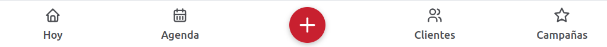
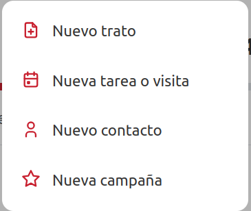
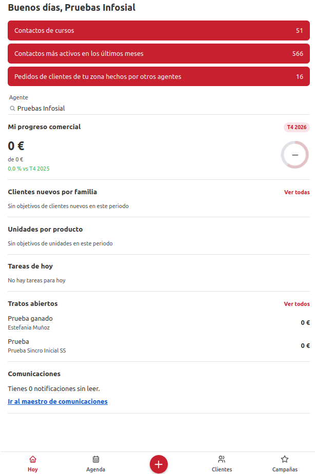
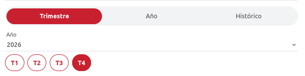
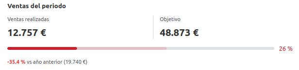

# Primeros pasos: acceso y navegación

---

## Quién puede usarla

La nueva versión de SmartSales es para los **usuarios que tienen un agente comercial asociado**. Todo lo que se muestra (tareas, tratos, clientes, ventas y objetivos) es el de ese agente.

Los **supervisores**, que tienen permiso para ver a otros agentes, pueden además consultar los datos de cualquiera de ellos (ver [Ver los datos de otro agente](#ver-los-datos-de-otro-agente)).

## Cómo se entra

Hay dos formas de entrar:

- Pulsando **SmartSales** en la barra superior, junto al logotipo. Este acceso solo aparece a los usuarios con agente asociado.
- Desde el menú lateral, en **SmartSales > Hoy**.

En los dos casos se abre la pantalla **Hoy**, que es la pantalla de inicio.

<!-- CAPTURA acceso.png: conectado como un comercial (p. ej. ivanespinosa), cualquier pantalla de la aplicación. Que se vean la barra superior con el acceso "SmartSales" junto al logotipo y el menú lateral desplegado en SmartSales > Hoy. Marcar los dos accesos con un recuadro o una flecha. -->

## La barra de navegación

En la parte de abajo de la pantalla hay siempre una barra con los accesos principales:

| Botón                 | Qué abre                                                                                 |
| --------------------- | ---------------------------------------------------------------------------------------- |
| **Hoy**               | La pantalla de inicio: avisos, progreso del trimestre, tareas del día y tratos abiertos. |
| **Agenda**            | Las tareas y visitas por día, semana o mes.                                              |
| **+** (botón central) | El menú de **acciones rápidas** (ver más abajo).                                         |
| **Clientes**          | La lista de clientes del agente y, desde ella, el [mapa de clientes](./mapa.md).                      |
| **Campañas**          | Las campañas del agente.                                                                 |

El botón de la pantalla en la que estamos aparece resaltado.

<!-- CAPTURA barra_navegacion.png: pantalla Hoy (/ss/dashboard), recorte de la barra inferior con los cinco botones. Mejor en vista de móvil o ventana estrecha. -->

### Acciones rápidas

El botón **+** del centro despliega cuatro accesos directos para crear cosas desde cualquier pantalla:

- **Nuevo trato**
- **Nueva tarea o visita**
- **Nuevo contacto**
- **Nueva campaña**

Para cerrar el menú sin elegir nada, pulsamos de nuevo el botón (ahora con una **X**) o en cualquier parte fuera del menú.

<!-- CAPTURA acciones_rapidas.png: cualquier pantalla con la barra inferior, después de pulsar el botón "+", con el menú de acciones rápidas abierto. -->

### Otras pantallas

Algunas pantallas no están en la barra inferior y se abren desde la pantalla Hoy o desde otras:

| Pantalla             | Cómo se llega                                                   |
| -------------------- | --------------------------------------------------------------- |
| **Rendimiento**      | En Hoy, pulsando la cifra de ventas de "Mi progreso comercial". |
| **Objetivos**        | En Hoy, con "Ver todas" de "Clientes nuevos por familia".       |
| **Tratos**           | En Hoy, con "Ver todos" de "Tratos abiertos".                   |
| **Tareas atrasadas** | En Hoy, con el aviso "Tienes N tareas atrasadas".               |
| [**Mapa de clientes**](./mapa.md) | En Clientes, con el botón **Mapa**.                             |

<!-- CAPTURA accesos_hoy.png: pantalla Hoy con datos (ivanespinosa). Marcar con flechas: la cifra de ventas de "Mi progreso comercial" (lleva a Rendimiento), "Ver todas" de "Clientes nuevos por familia" (Objetivos), "Ver todos" de "Tratos abiertos" (Tratos) y el aviso de tareas atrasadas. Puede hacer falta en dos capturas si no cabe. -->

## Ver los datos de otro agente

Los supervisores ven en Hoy, Agenda, Tratos, Rendimiento, Objetivos y Campañas un campo **Agente**. Al elegir otro agente, la pantalla muestra los datos de ese agente en lugar de los propios.

- Podemos buscar el agente escribiendo parte de su nombre.
- **El agente elegido se mantiene al cambiar de pantalla** durante toda la sesión. Es decir, si elegimos un agente en Hoy y luego vamos a Rendimiento, seguiremos viendo los datos de ese agente.
- Para volver a nuestros propios datos, elegimos nuestro nombre en el mismo campo. Al cerrar la sesión y volver a entrar, se vuelve también al agente propio.

Los usuarios que solo pueden ver su propio agente no ven este campo.

<!--  -->

<!-- CAPTURA selector_agente.png: conectado como supervisor (ivanespinosa), pantalla Hoy o Rendimiento, con el campo "Agente" desplegado mostrando la lista de agentes. -->

## Elegir el periodo

Las pantallas de **Rendimiento** y **Objetivos** tienen un selector de periodo con tres pestañas:

| Pestaña       | Qué permite                                                                                                                                              |
| ------------- | -------------------------------------------------------------------------------------------------------------------------------------------------------- |
| **Trimestre** | Elegir el año y uno o varios trimestres (T1, T2, T3, T4), pulsando cada uno para marcarlo o desmarcarlo. Al entrar, aparece marcado el trimestre actual. |
| **Año**       | Elegir un año completo (los cuatro trimestres).                                                                                                          |
| **Histórico** | Indicar unas fechas cualesquiera, **Desde** y **Hasta**. No está disponible en Objetivos.                                                                |

Se pueden consultar el año actual y los dos anteriores.

<!-- CAPTURA selector_periodo.png: pantalla Rendimiento (/ss/mi-rendimiento), recorte del selector de periodo en la pestaña "Trimestre" con T4 marcado. Si se puede, una segunda imagen (selector_periodo_historico.png) con la pestaña "Histórico" y las dos fechas. -->

## Indicador de progreso

En varias pantallas el avance hacia un objetivo se muestra con una barra (o un círculo, en Hoy) que tiene **dos rellenos**:

- El **relleno oscuro** es lo **conseguido**: el porcentaje del objetivo que llevamos alcanzado.
- El **relleno claro** es el **tiempo transcurrido**: el porcentaje del periodo que ya ha pasado.

Así se ve de un vistazo si vamos al ritmo necesario: si el relleno oscuro va **por delante** del claro, vamos por encima del ritmo para cumplir el objetivo; si va **por detrás**, vamos por debajo.

Por ejemplo, a mitad de un trimestre (relleno claro al 50 %), con un 26 % del objetivo conseguido (relleno oscuro al 26 %), vamos por debajo del ritmo.

<!-- CAPTURA indicador_progreso.png: recorte de una barra de progreso donde se distingan bien los dos rellenos (p. ej. la de "Ventas del periodo" en Rendimiento, T4 2026). -->

[Volver al Índice](./index.md)
