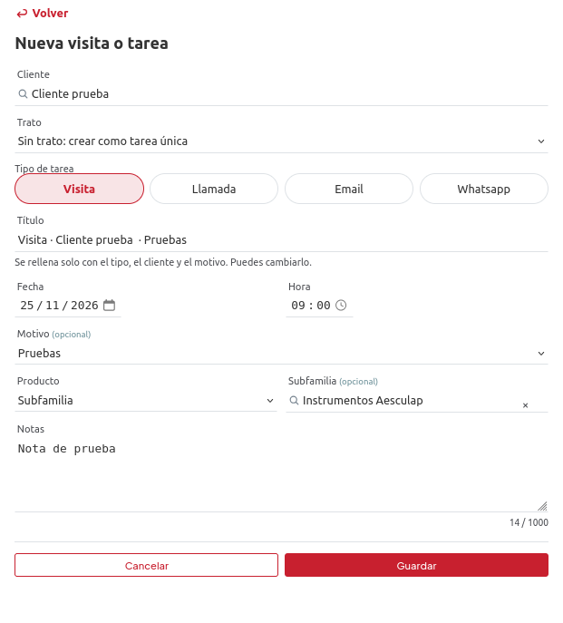
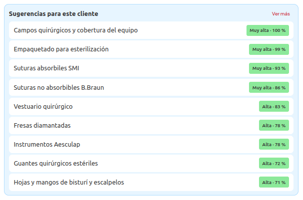
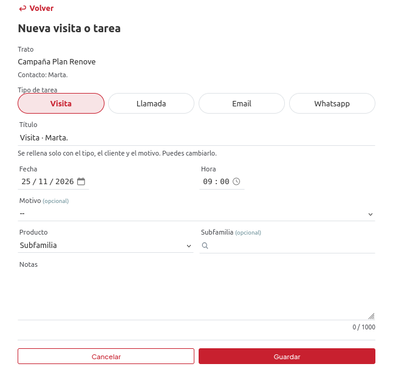

# Nueva visita o tarea

---

Pantalla para programar una visita, llamada, email o WhatsApp con un cliente. Se abre desde:

- el botón **+** de la barra inferior, opción **Nueva tarea o visita**;
- **+ Añadir a la agenda** en la Agenda;
- **+ Visita** en el [mapa de clientes](./mapa.md) (en la lista y en la tarjeta del cliente seleccionado), con el cliente ya elegido;
- **+ Tarea** en la ficha de un cliente (en sus acciones y en el aviso "Sin próxima acción"), con el cliente ya elegido;
- **+ Visita** en el detalle de una campaña, con el cliente y su trato de la campaña ya elegidos;
- **+ Tarea** en el detalle de un trato, con el cliente y el trato ya elegidos (ver también [Trato sin cliente](#trato-sin-cliente)).

<!-- CAPTURA nueva_tarea.png: /ss/mi-tarea/nueva con un cliente elegido (que tenga sugerencias), tipo Visita, motivo y producto rellenos. Pantalla completa. -->

## Campos

| Campo | Qué es |
| --- | --- |
| **Cliente** | Obligatorio. Se busca por nombre, código o CIF/NIF; no aparecen los clientes dados de baja. |
| **Trato** | Aparece al elegir el cliente. Por defecto es **"Sin trato: crear como tarea única"**; también se puede elegir uno de los tratos abiertos del cliente. Si la pantalla se abrió desde un trato, ese trato viene elegido. |
| **Tipo de tarea** | Visita, Llamada, Email o Whatsapp. Por defecto, Visita. |
| **Título** | Obligatorio, hasta 100 caracteres. Viene relleno automáticamente (ver [Título de la tarea](#título-de-la-tarea)) y se puede cambiar. |
| **Fecha** y **Hora** | Obligatorias. Por defecto, hoy a la hora en punto actual. |
| **Motivo** | Opcional. Lista de motivos que mantiene la administración (ver [Motivos de tarea](#motivos)). |
| **Producto** | Opcional. Primero se elige el nivel (**Artículo**, **Familia** o **Subfamilia**) y después se busca por código o por descripción (sin necesidad de poner tildes). |
| **Notas** | Opcional, hasta 1.000 caracteres. Se pueden **dictar** con el micrófono. |

## Sugerencias para el cliente

Al elegir el cliente aparece, si las hay, la lista **"Sugerencias para este cliente"**: las subfamilias de productos que el modelo de recomendación considera con **afinidad superior al 70 %** para ese cliente, con su porcentaje. Con **Ver más** se muestran también las de menor afinidad.

Al pulsar una sugerencia se rellena el **Producto** con esa subfamilia.

<!-- CAPTURA nueva_tarea_sugerencias.png: recorte del bloque "Sugerencias para este cliente" con varias subfamilias y su afinidad. -->

## Título de la tarea

El campo **Título** viene relleno con un título que se forma automáticamente con el tipo, el cliente (o el contacto, en un trato sin cliente) y el motivo, por ejemplo "Visita · Clínica Dental Ejemplo · Presentación de producto". Mientras no lo toquemos, se actualiza solo al cambiar el tipo, el cliente o el motivo, y debajo se indica "Se rellena solo con el tipo, el cliente y el motivo".

En cuanto escribimos en el campo, se respeta lo que hayamos puesto y deja de cambiar solo. El título también se puede cambiar después [editando la tarea](./tarea.md#editar-la-tarea).

## Tarea única (sin trato)

Si se deja **"Sin trato"**, al guardar se crea un trato de tipo **"Tarea única"** con esta única tarea. Así toda tarea queda asociada a un trato, aunque no exista una oportunidad de venta previa. Cuando esa tarea se complete, se preguntará cómo ha terminado el trato (ver [Cerrar el trato](./tarea.md#cerrar-el-trato)).

## Trato sin cliente

Algunos tratos no tienen cliente, solo un **contacto** (por ejemplo, los que vienen de marketing). Al pulsar **+ Tarea** en uno de ellos, en lugar de los campos **Cliente** y **Trato** se muestran el título del trato y su contacto, y no hace falta elegir cliente. La tarea se crea **en ese trato**, y al guardar se vuelve al detalle del trato.

En estas tareas no hay sugerencias de productos, porque se calculan por cliente.

<!-- CAPTURA nueva_tarea_sin_cliente.png: Nueva tarea abierta con "+ Tarea" desde un trato que solo tiene contacto, mostrando el bloque "Trato" con el título y el contacto. -->

## Guardar

**Guardar** crea la tarea para el comercial conectado y abre la [Agenda](./agenda.md) (o vuelve al trato, si es un trato sin cliente). Si falta algún dato obligatorio, se indica debajo del formulario. **Cancelar** vuelve a la pantalla anterior sin guardar.

## Motivos

Los motivos de tarea se mantienen desde **SmartSales > Motivos de tarea** en el menú lateral. Solo los usuarios del grupo de administración pueden crearlos, cambiarlos o darlos de baja; en las tareas solo se ofrecen los motivos activos.

[Volver al Índice](./index.md)
