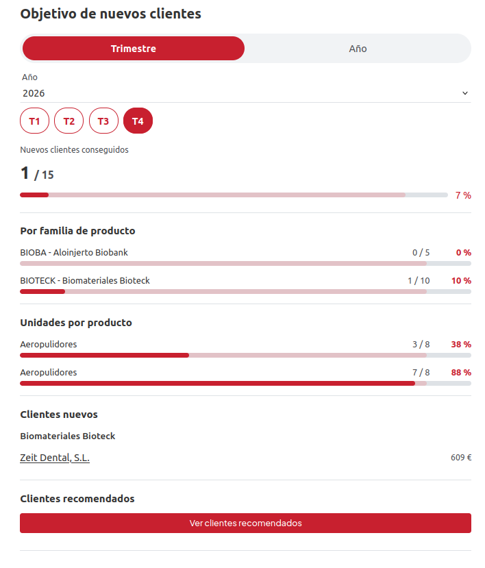
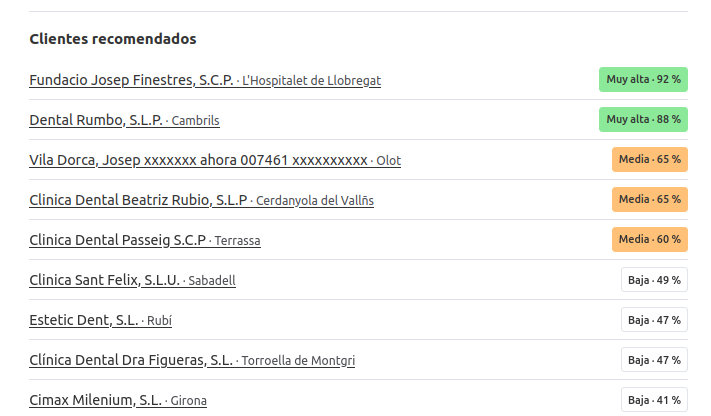

# Objetivo de nuevos clientes

---

Esta pantalla muestra cómo va el comercial en sus objetivos de **captación de clientes nuevos** y de **unidades vendidas**, quiénes son los clientes nuevos que ya ha conseguido y qué clientes le recomienda el modelo para seguir captando.

Se abre desde la pantalla **Hoy**, con **Ver todas** en "Clientes nuevos por familia".

<!-- CAPTURA objetivos.png: ivanespinosa, /ss/mi-objetivo, trimestre actual, con el total, la lista por familia y, si es posible, algún cliente nuevo. -->

Los objetivos se configuran en el ERP, en los [KPIs por agente](../../sh_kpiagentes/sh_kpiagentes.md). Los datos conseguidos se calculan **en el momento** a partir de las facturas, como en la pantalla Hoy (ver [Clientes nuevos por familia](./hoy.md#clientes-nuevos-por-familia)).

## Agente y periodo

- Los supervisores pueden elegir el agente con el campo **Agente** (ver [Ver los datos de otro agente](./navegacion.md#ver-los-datos-de-otro-agente)).
- El selector de periodo tiene las pestañas **Trimestre** y **Año** (aquí no hay fechas libres, porque los objetivos son por trimestre). Al entrar está marcado el **trimestre actual**. Con varios trimestres elegidos, los objetivos y lo conseguido de cada familia se suman.

## Nuevos clientes conseguidos

El total de clientes nuevos conseguidos frente al objetivo, sumando todas las líneas de familia y subfamilia, con su porcentaje y la barra de progreso (conseguido frente a tiempo transcurrido del periodo de los objetivos; ver [Indicador de progreso](./navegacion.md#indicador-de-progreso)).

Un mismo cliente que es nuevo en una familia y en una de sus subfamilias, si las dos tienen objetivo, cuenta en las dos líneas.

## Por familia de producto

Una línea por cada familia o subfamilia con objetivo de clientes nuevos: su nombre, **conseguidos / objetivo**, el porcentaje y la barra de progreso. Aparecen de menor a mayor porcentaje, para que lo más retrasado quede arriba. Es la misma información que en la pantalla Hoy, pero del periodo elegido.

## Unidades por producto

Una línea por cada producto o grupo de productos con objetivo de unidades: **unidades vendidas / objetivo**, el porcentaje y la barra de progreso. Ver [Unidades por producto](./hoy.md#unidades-por-producto).

## Clientes nuevos

Los clientes nuevos que ya cuentan para el objetivo, agrupados por familia o subfamilia. Para cada uno se ve su nombre (con enlace a su [ficha](./clientes.md#ficha-de-cliente)) y lo que se le ha facturado de esa familia en el periodo.

## Clientes recomendados

<!-- CAPTURA objetivos_recomendados.png: recorte de "Clientes recomendados" tras pulsar el botón, con varios clientes y su afinidad. -->

El botón **Ver clientes recomendados** busca, entre los clientes del comercial, los que el modelo de recomendación considera más afines a las familias y subfamilias de sus objetivos: candidatos para conseguir clientes nuevos. Se muestran de **mayor a menor afinidad**, de 20 en 20 (**Ver más** trae los siguientes). Cada uno muestra su nombre, su ciudad y su nivel de afinidad (ver [Afinidad](./mapa.md#afinidad)); al pulsar el nombre se abre su ficha.

El botón no está disponible si en el periodo no hay objetivos de clientes nuevos.

[Volver al Índice](./index.md)
