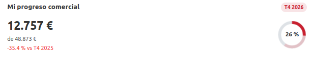
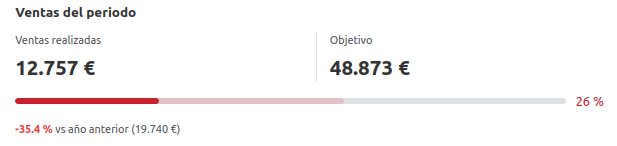
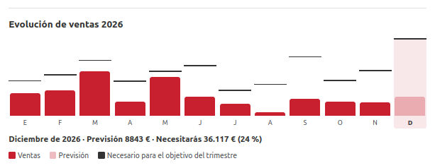
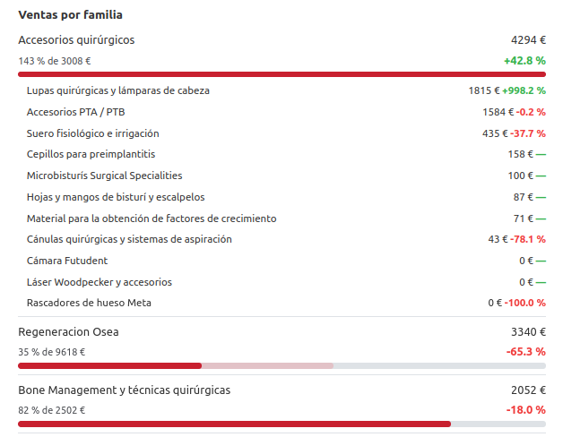

# Rendimiento

---

La pantalla de Rendimiento muestra cómo van las ventas del agente en el periodo elegido: cuánto ha vendido, frente a qué objetivo, cómo se compara con el año anterior, cómo evolucionan las ventas mes a mes y en qué familias de productos se reparten.

Se abre desde la pantalla **Hoy**, pulsando la cifra de ventas de "Mi progreso comercial".



<!-- CAPTURA rendimiento.png: ivanespinosa, /ss/mi-rendimiento, pestaña Trimestre, T4 del año actual, con su propio agente. Pantalla completa (si no cabe, la parte superior hasta el gráfico). -->

## Agente y periodo

En la parte de arriba están:

- El campo **Agente**, solo para supervisores, para consultar los datos de otro agente. El agente elegido se mantiene en el resto de pantallas (ver [Ver los datos de otro agente](./navegacion.md#ver-los-datos-de-otro-agente)).
- El **selector de periodo**, con las pestañas Trimestre, Año e Histórico (ver [Elegir el periodo](./navegacion.md#elegir-el-periodo)). Al entrar está marcado el **trimestre actual**.

Todos los datos de la pantalla se recalculan al cambiar el agente o el periodo.

## Qué ventas se cuentan

En toda la pantalla, las ventas son el **importe facturado**: la suma de las líneas de las **facturas de venta** cuyo agente es el consultado y cuya fecha está dentro del periodo. Los importes son **sin IVA**. No se cuentan los pedidos ni los albaranes que aún no se han facturado.

Dos detalles importantes:

- **Periodo en curso:** si el periodo incluye el trimestre actual, las ventas se cuentan **hasta hoy**.
- **Comparación con el año anterior:** se hace con **el mismo tramo de fechas del año anterior**. Por ejemplo, si hoy es 24 de noviembre y consultamos el T4, se comparan las ventas del 1 de octubre al 24 de noviembre de este año con las del 1 de octubre al 24 de noviembre del año pasado.

## Ventas del periodo



<!-- CAPTURA rendimiento_ventas_periodo.png: recorte de la tarjeta "Ventas del periodo" (ivanespinosa, T4 del año actual). -->

| Dato                              | Qué expresa                                                                                                                                                                                                                                                                              |
| --------------------------------- | ---------------------------------------------------------------------------------------------------------------------------------------------------------------------------------------------------------------------------------------------------------------------------------------- |
| **Ventas realizadas**             | Lo facturado por el agente en el periodo, **solo de las familias de productos que cuentan para la previsión** de ventas y sin las series de facturación excluidas de la previsión. Es el mismo criterio que se usa para calcular las comisiones.                                         |
| **Objetivo**                      | La suma de los objetivos de ventas del agente para los trimestres del periodo, **siempre de trimestres completos**. El objetivo de cada trimestre es el objetivo inicial de su previsión, descontando lo que otros agentes han facturado a los clientes de este agente en ese trimestre. |
| **Porcentaje** (junto a la barra) | Ventas realizadas entre objetivo, en %.                                                                                                                                                                                                                                                  |
| **Barra de progreso**             | El relleno oscuro es el porcentaje conseguido y el claro, el tiempo transcurrido del periodo (ver [Indicador de progreso](./navegacion.md#indicador-de-progreso)).                                                                                                                       |
| **± % vs año anterior**           | Cuánto han subido (en verde) o bajado (en rojo) las ventas respecto al mismo tramo de fechas del año anterior. Entre paréntesis, las ventas de ese tramo del año anterior. Si el año anterior no hubo ventas, se muestra "—".                                                            |

Con la pestaña **Histórico**, las ventas son las de las fechas indicadas, pero el objetivo es el de los trimestres completos que tocan esas fechas. Por ejemplo, del 1 al 31 de octubre las ventas son solo las de octubre, pero el objetivo es el de todo el T4, por lo que el porcentaje sale más bajo de lo que correspondería a ese mes.

### Fórmulas

- **Porcentaje**:

```xls
  (Ventas realizadas / Objetivo) * 100
```

- **Variación respecto al año anterior**:

```xls
  ((Ventas realizadas * 100) / Ventas del año anterior) - 100
```

## Evolución de ventas



<!-- CAPTURA rendimiento_evolucion.png: recorte de la tarjeta "Evolución de ventas" (ivanespinosa, año actual), con un mes ya pasado pulsado (p. ej. octubre) para que se vean resaltada su columna y la línea de importes debajo del gráfico. -->

Gráfico con una columna por cada mes del año (de enero a diciembre). El año es el del periodo elegido.

| Elemento                                                        | Qué expresa                                                                                                                                                                |
| --------------------------------------------------------------- | -------------------------------------------------------------------------------------------------------------------------------------------------------------------------- |
| **Barra oscura** (Ventas)                                       | Lo facturado por el agente **en ese mes**, con el mismo criterio que "Ventas realizadas". El mes en curso muestra lo facturado hasta hoy.                                  |
| **Barra clara** (Previsión)                                     | En los meses que aún no han llegado, las ventas que prevé para ese mes el modelo de previsión de ventas.                                                                   |
| **Línea horizontal** (Necesario para el objetivo del trimestre) | Lo que hace falta vender **ese mes** para cumplir el objetivo del trimestre, teniendo en cuenta lo ya vendido en los meses anteriores del mismo trimestre (ver más abajo). |

Las barras muestran lo de cada mes por separado: el gráfico **no acumula** las ventas a lo largo del año.

### Cómo se calcula lo necesario de cada mes

Los objetivos de ventas son **trimestrales** (el mismo objetivo que en "Ventas del periodo"). Lo necesario de cada mes es lo que queda por vender del trimestre, repartido entre los meses que faltan:

- **Primer mes del trimestre:** el objetivo del trimestre entre 3.
- **Segundo mes:** lo que queda del objetivo después de las ventas del primer mes, entre 2.
- **Tercer mes:** todo lo que queda del objetivo después de las ventas de los dos primeros meses.

Así, si un mes se vende menos de lo necesario, la línea de los meses siguientes **sube** para recuperarlo; si se vende más, **baja**. Si el objetivo del trimestre ya está cubierto, los meses que quedan no tienen línea.

En los meses que aún no han llegado, se supone que cada uno cumple su parte, de modo que lo que queda se reparte a partes iguales entre ellos. En el mes en curso, lo necesario del mes siguiente se calcula con lo vendido hasta hoy, así que puede cambiar a medida que avanza el mes.

Por ejemplo, con un objetivo trimestral de 198.000 €:

| Mes       | Ventas   | Necesario                                |
| --------- | -------- | ---------------------------------------- |
| Octubre   | 63.000 € | 198.000 / 3 = **66.000 €**               |
| Noviembre | 45.000 € | (198.000 − 63.000) / 2 = **67.500 €**    |
| Diciembre | —        | 198.000 − 63.000 − 45.000 = **90.000 €** |

Al empezar un nuevo trimestre, el cálculo vuelve a empezar con el objetivo de ese trimestre.

### Ver los importes de un mes

Al **pulsar una columna** , queda resaltada y debajo del gráfico aparecen sus importes. Por ejemplo:

```text
Octubre de 2026 · Ventas 63.039 € · Necesitabas 66.022 € (95 %)
```

- En los meses que ya han pasado y en el mes en curso se muestran las **ventas**; en los que aún no han llegado, la **previsión**.
- Lo necesario aparece como "Necesitabas" en los meses pasados, "Necesitas" en el mes en curso y "Necesitarás" en los siguientes.
- El porcentaje entre paréntesis es lo vendido (o lo previsto) frente a lo necesario de ese mes.
- Si el objetivo del trimestre ya está cubierto, se indica "Objetivo del trimestre cubierto"; si el trimestre no tiene objetivo, "Sin objetivo".

Al entrar en la pantalla aparece elegido el **mes actual**. Si consultamos un año anterior, no hay ningún mes elegido hasta que pulsamos uno.

## Ventas por familia



<!-- CAPTURA rendimiento_familias.png: recorte de la tarjeta "Ventas por familia" (ivanespinosa, T4 del año actual) con una familia desplegada mostrando sus subfamilias. Si hay alguna familia con "Sin objetivo", mejor que se vea también. -->

Una fila por cada familia de productos en la que el agente ha vendido en el periodo, o en la que tiene objetivo aunque no haya vendido nada. Las familias están ordenadas **de mayor a menor importe vendido**.

Las ventas de esta sección siguen el criterio del **informe de ventas por familia**: cuentan **todas** las familias, también las que no cuentan para la previsión. Los artículos sin familia se agrupan en "SIN FAMILIA". Por eso, la suma de todas las familias puede ser algo mayor que las "Ventas realizadas" de arriba.

### Datos de cada familia

| Dato                                     | Qué expresa                                                                                                                                                       |
| ---------------------------------------- | ----------------------------------------------------------------------------------------------------------------------------------------------------------------- |
| **Importe** (a la derecha del nombre)    | Lo facturado de esa familia en el periodo.                                                                                                                        |
| **"X % de Y €"**                         | Lo facturado de la familia frente a su objetivo. El objetivo es la suma de los objetivos por familia de las previsiones del agente en los trimestres del periodo. |
| **Familia sin objetivo en la previsión** | Si la familia no tiene objetivo, se toma como referencia lo que se vendió de ella **en el mismo tramo de fechas del año anterior**.                               |
| **"Sin objetivo"**                       | La familia no tiene objetivo ni ventas el año anterior con las que compararse.                                                                                    |
| **± %**                                  | Cuánto han subido (verde) o bajado (rojo) las ventas de la familia respecto al mismo tramo de fechas del año anterior. Si el año anterior no hubo ventas, "—".    |
| **Barra de progreso**                    | Porcentaje conseguido frente a tiempo transcurrido del periodo. Solo aparece si la familia tiene una referencia con la que compararse.                            |

### Subfamilias

Al pulsar sobre una familia se despliegan sus subfamilias, también de mayor a menor importe. Para cada una se muestra:

| Dato        | Qué expresa                                                                                           |
| ----------- | ----------------------------------------------------------------------------------------------------- |
| **Importe** | Lo facturado de esa subfamilia en el periodo. La suma de las subfamilias es el importe de la familia. |
| **± %**     | Variación respecto al mismo tramo de fechas del año anterior.                                         |

Las subfamilias no tienen objetivo propio: los objetivos de la previsión son por familia. Los artículos sin subfamilia se agrupan en "SIN SUBFAMILIA".

[Volver al Índice](./index.md)
