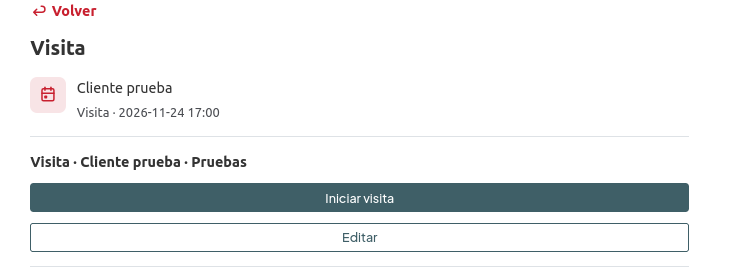
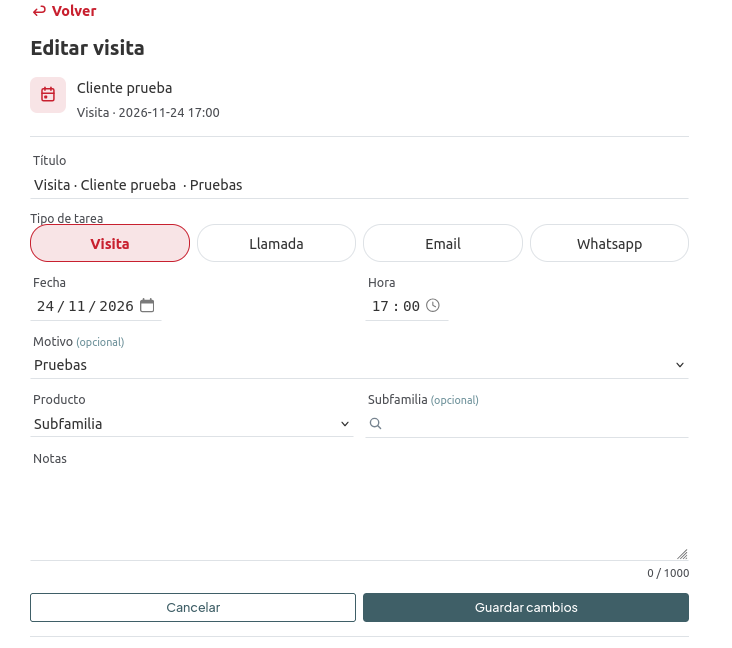
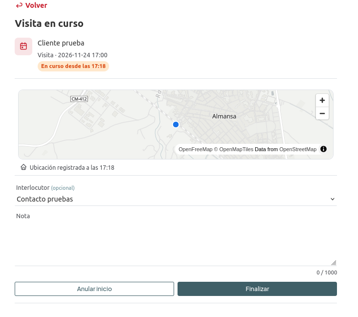
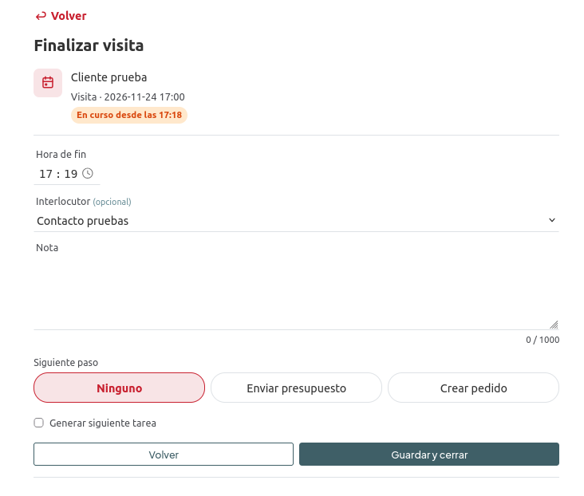
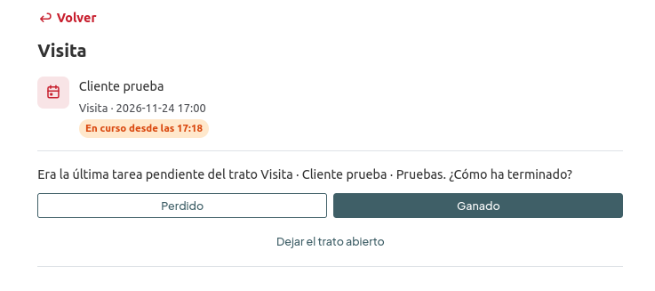

# Hacer una visita o tarea

---

Al pulsar una tarea (en Hoy, la Agenda, las tareas atrasadas, la ficha de un cliente o el detalle de un trato) se abre su pantalla. Desde ella se **inicia** la visita, se **completa** la tarea o se **edita**, y al terminar se pueden crear un presupuesto o un pedido y cerrar el trato.

Arriba aparecen siempre el **cliente**/**contacto**, el **tipo**, la **fecha** y la **hora** de la tarea y, si es una visita en curso, desde qué hora.

## Tarea pendiente

<!-- CAPTURA tarea_pendiente.png: una visita pendiente (ivanespinosa), con título, nota y los botones "Iniciar visita" y "Editar". -->

Se ven el título y la nota de la tarea, y estos botones:

| Botón               | Qué hace                                                                     |
| ------------------- | ---------------------------------------------------------------------------- |
| **Iniciar visita**  | Solo en las visitas. Ver [Iniciar una visita](#iniciar-una-visita).          |
| **Completar tarea** | En llamadas, emails y WhatsApp. Pasa directamente a [Finalizar](#finalizar). |
| **Editar**          | Ver [Editar la tarea](#editar-la-tarea).                                     |

## Editar la tarea

<!-- CAPTURA tarea_editar.png: el formulario de edición de una tarea pendiente. -->

Mientras la tarea está pendiente (y, si es una visita, no se ha iniciado), **Editar** permite cambiar el **título**, el **tipo**, la **fecha** y la **hora**, el **motivo**, el **producto** y la **nota**. Es la forma de, por ejemplo, pasar una visita a otro día.

**Guardar cambios** guarda la tarea (y actualiza el evento en Google Calendar si el comercial lo tiene sincronizado). **Cancelar**, o el botón **Volver** de arriba, descarta los cambios.

Para editar una visita ya iniciada, primero hay que [anular el inicio](#anular-el-inicio).

## Iniciar una visita

**Iniciar visita** registra la **hora de inicio** y la **ubicación** del comercial en ese momento (si el navegador da permiso para usarla), y la visita pasa a **En curso**.

- Solo puede iniciar la visita el **comercial al que está asignada**; un supervisor que está viendo la agenda de otro agente no puede iniciarla por él.
- Cada comercial solo puede tener **una visita en curso**. Si intenta iniciar otra, se le avisa de cuál tiene sin finalizar.
- Si una visita iniciada no se finaliza el mismo día, se da por finalizada automáticamente al día siguiente.

## Visita en curso

<!-- CAPTURA tarea_en_curso.png: una visita en curso, con el mapa de la ubicación de inicio, el interlocutor y la nota. -->

Mientras la visita está en curso se ve:

- un **mapa** con la ubicación registrada al iniciarla;
- **Interlocutor**: la persona con la que se ha hablado, a elegir entre los contactos del cliente (opcional);
- **Nota**: lo que se quiera anotar de la visita, escrita o **dictada** con el micrófono (hasta 1.000 caracteres).

El interlocutor y la nota se guardan al finalizar la visita.

### Anular el inicio

**Anular inicio** (con confirmación) devuelve la visita a pendiente, como si no se hubiera iniciado; sirve cuando se ha iniciado por error. Se borran la hora y la ubicación de inicio, y la nota y el interlocutor que no se hubieran guardado.

## Finalizar

<!-- CAPTURA tarea_finalizar.png: la pantalla "Finalizar visita" con hora de fin, interlocutor, nota, siguiente paso y "Generar siguiente tarea". -->

**Finalizar** (en una visita en curso) o **Completar tarea** (en el resto) abre el cierre de la tarea:

| Campo                       | Qué es                                                                                                                                        |
| --------------------------- | --------------------------------------------------------------------------------------------------------------------------------------------- |
| **Hora de fin**             | Obligatoria. Por defecto, la hora actual.                                                                                                     |
| **Interlocutor** y **Nota** | Como en la visita en curso.                                                                                                                   |
| **Siguiente paso**          | Solo si la tarea tiene trato: **Ninguno**, **Enviar presupuesto** o **Crear pedido**.                                                         |
| **Generar siguiente tarea** | Al terminar, abre una nueva tarea para el mismo cliente (y el mismo trato si sigue abierto). En un trato sin cliente, la nueva tarea es del mismo trato, siempre que siga abierto. No aparece si el siguiente paso es Crear pedido. |

**Guardar y cerrar** completa la tarea y registra la ubicación de fin. **Volver** regresa a la visita en curso sin completarla.

### Presupuesto o pedido

Si se ha elegido **Enviar presupuesto** o **Crear pedido**, se abre una ventana para crearlo:

- **Cliente**: solo si el trato no tiene cliente. En un presupuesto se puede marcar como **cliente no registrado** e indicar su nombre y, opcionalmente, su dirección.
- **Dirección de envío**: si el cliente tiene varias; si solo tiene una, ya viene elegida.
- **Origen de salida**: solo si la dirección de envío es de Canarias.
- **Evento**: obligatorio; por defecto, **venta regular**.

Si el trato ya tenía ese presupuesto o pedido, no se vuelve a crear. **Cancelar** cierra la ventana sin crear el documento (la tarea ya está completada).

Crear el pedido **gana el trato**.

### Cerrar el trato

<!-- CAPTURA tarea_cerrar_trato.png: la pregunta "Era la última tarea pendiente del trato… ¿Cómo ha terminado?" con los botones. -->

Si la tarea era la **última pendiente** de un trato abierto, se pregunta **cómo ha terminado el trato**:

- **Perdido**: hay que elegir la **causa de la pérdida** y pulsar **Marcar perdido**.
- **Ganado**, **Aprobar presupuesto** o **Crear pedido**: el botón depende del tipo de trato, con las mismas reglas que en el detalle del trato:
  - si el tipo de trato no exige pedido, o es una tarea única, el botón es **Ganado**;
  - si exige pedido y el trato tiene presupuesto, **Aprobar presupuesto** (lo convierte en pedido y gana el trato);
  - si exige pedido y no hay presupuesto, **Crear pedido** (abre la ventana del pedido);
  - en los tratos de **farma**, ganar lleva al detalle del trato para completar los datos de la licencia.
- **Dejar el trato abierto**: no cambia el trato.

## Al terminar

Cuando todo termina, la aplicación lleva a:

1. una **nueva tarea** para el mismo cliente, si se marcó **Generar siguiente tarea**;
2. si no, el **presupuesto o pedido** recién creado;
3. si no, la **Agenda**.

Si se abre una tarea ya completada, se indica "Esta tarea ya está completada".

[Volver al Índice](./index.md)
