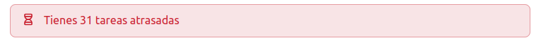

# Tareas atrasadas

---

Lista de las tareas pendientes cuya fecha y hora ya han pasado. Se abre desde la pantalla **Hoy**, pulsando el aviso **"Tienes N tareas atrasadas"** o el enlace **"Ver las N atrasadas de los últimos 90 días"**.

<!-- CAPTURA tareas_atrasadas.png: /ss/dashboard/atrasadas con un comercial que tenga atrasadas (si es posible, también con el botón "Ver las N de hace más de 90 días" visible al final). -->

## Cuándo una tarea está atrasada

Una tarea pendiente está **atrasada** cuando:

- su fecha es anterior a hoy, o
- es de hoy y su hora ya ha pasado.

Una tarea de hoy **sin hora** no está atrasada hasta el día siguiente. Las tareas completadas nunca están atrasadas. Igual que en la Agenda, solo se tienen en cuenta las tareas de tratos abiertos, las tareas sin trato y las de incidencias.

## Qué muestra la lista

1. Primero, las **atrasadas de hoy** (las de hoy cuya hora ya ha pasado).
2. Después, las de los **últimos 90 días**, de la más reciente a la más antigua. Encima se indica cuántas se están viendo del total ("Últimos 90 días: mostrando 50 de 120"). Se cargan de 50 en 50 con el botón **Cargar más**.
3. Al final, si hay tareas atrasadas de **hace más de 90 días**, el botón **"Ver las N de hace más de 90 días"** las muestra en un apartado aparte, también de 50 en 50.

Las de hace más de 90 días se separan porque suelen ser tareas antiguas que ya no se van a hacer; no se suman al aviso de la pantalla Hoy.

Cada tarea se muestra con su tarjeta, que aquí incluye también la **fecha** (en rojo) además de la hora. Al pulsarla se abre la tarea, desde donde se puede completar o editar, por ejemplo para pasarla a otro día.

Si no hay ninguna, aparece "No tienes tareas atrasadas en los últimos 90 días".

Los supervisores tienen arriba el campo **Agente** para ver las atrasadas de otro agente. Al entrar aparece el agente que tuvieran elegido en Hoy (ver [Ver los datos de otro agente](./navegacion.md#ver-los-datos-de-otro-agente)). Quien solo puede ver su propio agente no ve este campo.

[Volver al Índice](./index.md)
