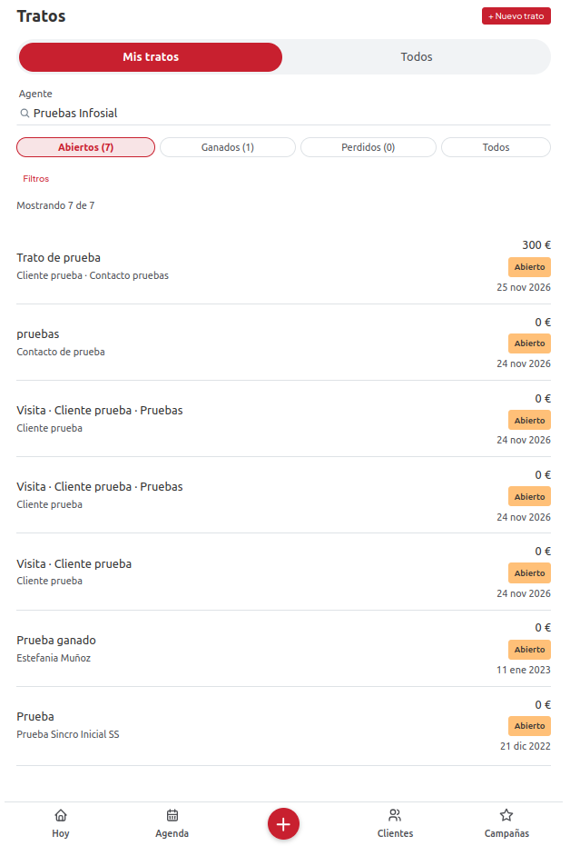
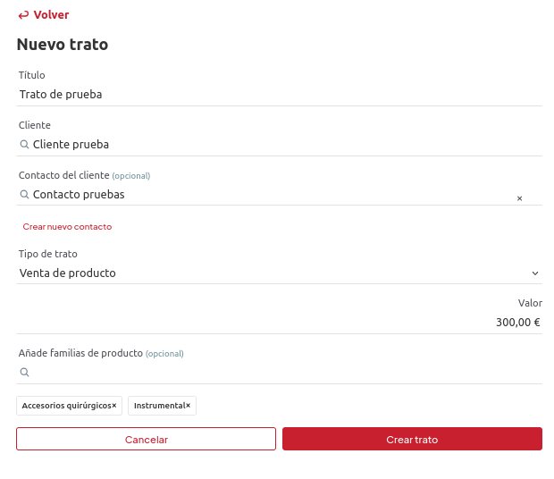
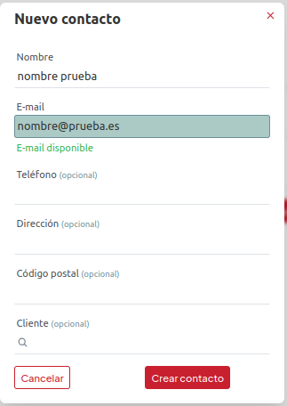
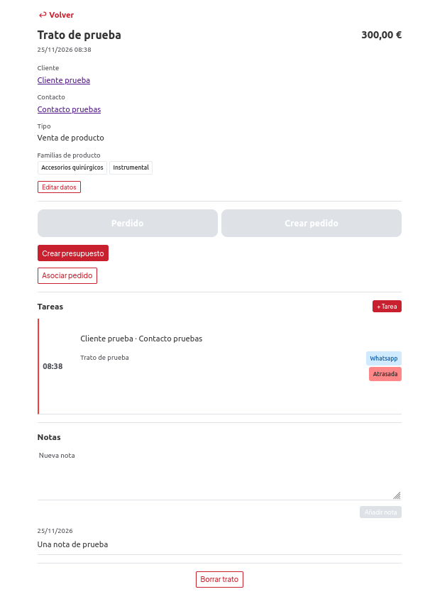

# Tratos

---

Un **trato** es una oportunidad de venta con un cliente o un contacto: tiene un título, un tipo, un valor y sus tareas, y termina **ganado** o **perdido**. Desde esta parte se consultan los tratos, se crean nuevos y se gestionan.

La lista se abre desde la pantalla **Hoy**, con **Ver todos** en "Tratos abiertos".

## Lista de tratos

<!-- CAPTURA tratos.png: ivanespinosa, /ss/mis-tratos, pestaña "Mis tratos", contador "Abiertos" marcado, con varios tratos (alguno con etiqueta MKT, FARMA o CAMPAÑA). -->

### Mis tratos y Todos

- **Mis tratos**: los tratos en los que el agente es el **responsable** o figura como **observador**. Los supervisores pueden elegir aquí de qué agente con el campo **Agente**.
- **Todos**: solo para quien puede ver a otros agentes; muestra los tratos de todos los agentes que puede ver. En esta pestaña cada trato indica también su **agente**, debajo del cliente y el contacto.

### Contadores por estado

Los botones **Abiertos**, **Ganados** y **Perdidos** muestran cuántos tratos hay en cada estado (con los filtros aplicados) y, al pulsarlos, la lista muestra solo los de ese estado. **Todos** muestra los tres estados juntos. Al entrar aparece marcado **Abiertos**.

### Filtros

El botón **Filtros** despliega estos campos (se aplican solos al escribir):

| Filtro                | Busca por                      |
| --------------------- | ------------------------------ |
| **Título**            | Parte del título del trato.    |
| **Contacto**          | Parte del nombre del contacto. |
| **Código de cliente** | El código exacto del cliente.  |
| **CIF/NIF**           | Parte del CIF/NIF del cliente. |
| **Desde** / **Hasta** | La fecha del trato.            |

### La lista

Los tratos aparecen del más reciente al más antiguo, de 50 en 50 (**Cargar más** trae los siguientes), con el texto "Mostrando N de total" encima. Cada uno se muestra en su tarjeta (ver [Tratos abiertos](./hoy.md#tratos-abiertos) en la pantalla Hoy): título, etiqueta de origen (**MKT**, **FARMA** o **CAMPAÑA**), cliente y contacto, valor, estado y fecha. Al pulsar un trato se abre su detalle.

El botón **+ Nuevo trato** abre el alta de trato.

## Nuevo trato

<!-- CAPTURA nuevo_trato.png: /ss/mi-trato/nuevo con título, cliente, contacto, tipo, valor y alguna familia añadida. -->

Se abre con **+ Nuevo trato** en la lista, con la opción **Nuevo trato** del botón **+** de la barra inferior, o con **Crear trato** en una oportunidad recomendada de la ficha de un cliente (en ese caso vienen ya el cliente, el producto, el título y, si es un artículo, su precio como valor).

| Campo                    | Qué es                                                                                                                                        |
| ------------------------ | --------------------------------------------------------------------------------------------------------------------------------------------- |
| **Título**               | Obligatorio, hasta 100 caracteres.                                                                                                            |
| **Cliente**              | El cliente del trato.                                                                                                                         |
| **Contacto**             | Si hay cliente, uno de sus contactos; si no, cualquier contacto. Si no existe, se puede dar de alta con **Crear nuevo contacto** (ver abajo). |
| **Tipo de trato**        | Obligatorio.                                                                                                                                  |
| **Valor**                | El importe previsto del trato (no puede ser negativo).                                                                                        |
| **Familias de producto** | Las familias que interesan al cliente; se añaden buscándolas y se quitan con la **×** de su etiqueta.                                         |

Hay que indicar **un cliente o un contacto** (o los dos). Los tratos de tipo **farma** exigen cliente y contacto, y solo los pueden crear los usuarios con permiso para ese tipo.

### Crear un contacto nuevo

<!--  -->
<!-- CAPTURA nuevo_trato_contacto.png: en Nuevo trato, la ventana "Nuevo contacto" abierta tras pulsar "Crear nuevo contacto", con nombre y e-mail rellenos (y el mensaje "E-mail disponible"). -->

Debajo del campo **Contacto**, el enlace **Crear nuevo contacto** abre la ventana **Nuevo contacto** para darlo de alta sin salir del formulario del trato:

| Campo                                           | Qué es                                                                                                                                                                                                                                                                                      |
| ----------------------------------------------- | ------------------------------------------------------------------------------------------------------------------------------------------------------------------------------------------------------------------------------------------------------------------------------------------- |
| **Nombre**                                      | Obligatorio.                                                                                                                                                                                                                                                                                |
| **E-mail**                                      | Obligatorio. Mientras se escribe se comprueba que tiene un formato válido y, al terminar, si ya existe un contacto con ese e-mail: se indica "E-mail disponible" o, si ya existe, "El contacto ya existe" con un enlace para ir a él. No se puede crear un contacto con un e-mail repetido. |
| **Teléfono**, **Dirección** y **Código postal** | Opcionales.                                                                                                                                                                                                                                                                                 |
| **Cliente**                                     | Opcional. Si en el trato ya se ha elegido un cliente, viene ese cliente.                                                                                                                                                                                                                    |

**Crear contacto** lo da de alta, cierra la ventana y lo deja elegido como contacto del trato. **Cancelar** cierra la ventana sin crearlo.

El mismo alta de contacto está también en la opción **Nuevo contacto** del botón **+** de la barra inferior; desde ahí, al crearlo se abre la ficha del contacto.

**Crear trato** guarda el trato a nombre del comercial conectado y abre su detalle. Si el trato tiene un contacto que no está en la lista de contactos del comercial, antes se pregunta si se quiere **asociar** a su lista.

## Detalle del trato

<!-- CAPTURA trato.png: el detalle de un trato abierto con cliente, con datos, botones Perdido / Ganado, presupuesto, tareas y notas. -->

Arriba aparecen el **título**, la **fecha** y el **valor** del trato. Debajo, estas partes:

### Datos

**Cliente** (con enlace a su ficha), **Contacto** (con enlace a su ficha), **Tipo** y **Familias de producto**.

Con **Editar datos** se pueden cambiar el título, el valor, el tipo, el contacto (entre los del cliente) y las familias. **Guardar** guarda los cambios; **Cancelar**, o el botón **Volver** de arriba, los descarta.

### Perdido y Ganado

Los dos botones cambian el estado del trato. El que corresponde al estado actual aparece marcado; al pulsarlo otra vez, el trato **vuelve a abierto**.

- **Perdido** pide la **causa de la pérdida**. No se puede marcar como perdido un trato que ya tiene pedido o licencia.
- El botón de ganar depende del tipo de trato:

| Botón                   | Cuándo                                                 | Qué hace                                                                                                                                               |
| ----------------------- | ------------------------------------------------------ | ------------------------------------------------------------------------------------------------------------------------------------------------------ |
| **Ganado**              | El tipo de trato no exige pedido, o es una tarea única | Marca el trato como ganado.                                                                                                                            |
| **Aprobar presupuesto** | El tipo exige pedido y el trato tiene presupuesto      | Convierte el presupuesto en pedido, lo envía a la PDA y gana el trato.                                                                                 |
| **Crear pedido**        | El tipo exige pedido y no hay presupuesto              | Abre la ventana del pedido (ver abajo); al crearlo, el trato queda ganado.                                                                             |
| **Ganado** (farma)      | Tratos de farma                                        | Pide la **fecha de finalización del proceso** y la **fecha de caducidad** de la licencia, crea la licencia y gana el trato. Solo con permiso de farma. |

Si el trato estaba perdido, se muestra la causa debajo de los botones.

### Presupuesto y pedido

- Si el trato tiene **pedido** o **presupuesto**, aparecen con su código y un enlace para abrirlos.
- **Crear presupuesto**: mientras el trato no tenga presupuesto ni pedido y no esté perdido. Abre la misma ventana que al finalizar una visita (ver [Presupuesto o pedido](./tarea.md#presupuesto-o-pedido)): cliente si el trato no lo tiene (también **no registrado**), dirección de envío, origen de salida si es de Canarias y evento. Al crearlo se abre el presupuesto para añadir las líneas.
- **Asociar pedido**: si el tipo de trato exige pedido y el trato aún no tiene presupuesto ni pedido, permite elegir un **pedido ya existente** del cliente. Al asociarlo, el trato queda ganado (y, si no tenía cliente, toma el del pedido).

Para crear un presupuesto o un pedido el trato tiene que tener un agente asignado.

### Tareas

Las tareas del trato, con la misma tarjeta que en la Agenda. Al pulsar una se abre la tarea. El botón **+ Tarea** abre [Nueva tarea](./nueva_tarea.md) con el trato ya elegido (también si el trato no tiene cliente); solo lo ven el comercial responsable del trato y los superusuarios.

### Notas

Notas libres del trato. Se escribe en **Nueva nota** y se pulsa **Añadir nota**. Debajo aparecen las notas anteriores con su fecha.

### Borrar el trato

**Borrar trato** (con confirmación) elimina el trato definitivamente, junto con sus tareas y su presupuesto si los tiene. Solo aparece si el trato no está ganado y:

- es del comercial conectado, o
- el usuario tiene permiso para borrar tratos de otros (excepto los de farma, que solo puede borrar su responsable).

[Volver al Índice](./index.md)
